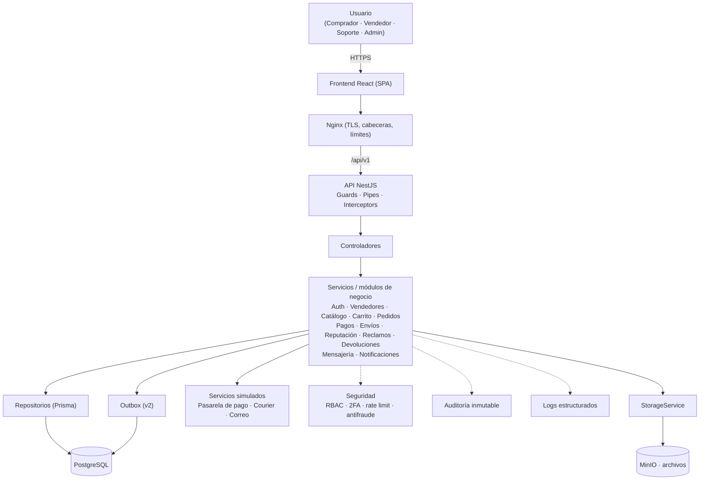
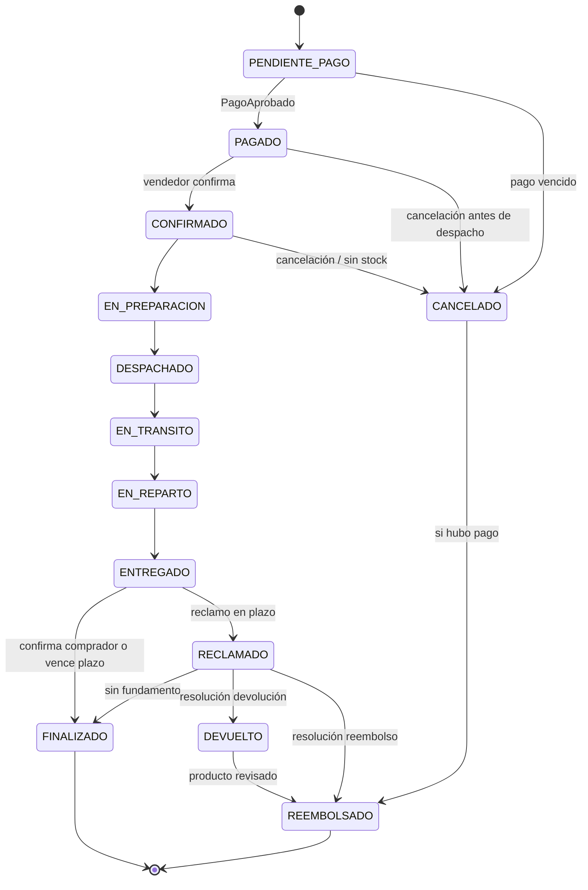
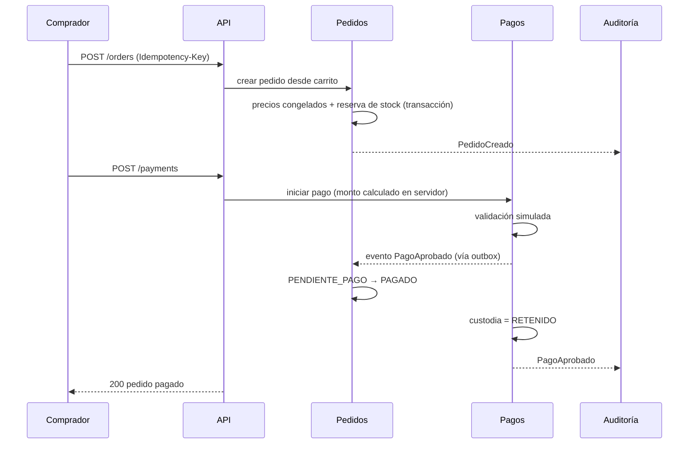

# TIENDA VIRTUAL SEGURA
## Especificaciones tecnológicas y diseño técnico: versión 2 (unificada y ampliada)

> Proyecto académico. Pagos y envíos simulados. Este documento **no cambia ninguna regla funcional**: define cómo construir lo ya definido en el documento funcional v2.
>
> **Qué cambió en esta versión.** Se conserva todo el contenido de la v1 técnica. Se corrigieron inconsistencias, se añadieron los elementos funcionales que no tenían diseño técnico, y se integró el contexto para el CLI **opencode**. Lo agregado o modificado está marcado con **(v2)**. En caso de conflicto, esta versión prevalece sobre la v1.

**Nota sobre versiones.** Las versiones indicadas son las líneas mayores recomendadas a la fecha del documento. Al iniciar el desarrollo, el equipo debe confirmar la última versión estable/LTS de cada herramienta y fijarla (lockfile y tags de imagen Docker con versión exacta, nunca `latest`). **(v2)** Además: registrar la fecha de verificación y las versiones elegidas en un ADR; añadir `.nvmrc` y los campos `engines` y `packageManager` en `package.json`; en producción fijar también el digest (`@sha256:`) de las imágenes.

---

## 1. Resumen tecnológico

| Decisión | Selección |
|---|---|
| Arquitectura | Monolito modular (un backend, un frontend, una base de datos) |
| Lenguaje único | TypeScript en frontend y backend (menos curva de aprendizaje, tipos y validaciones compartidos) |
| Frontend | React + Vite + React Router, Tailwind CSS + Radix/shadcn-ui, TanStack Query, React Hook Form + Zod |
| Backend | NestJS (Node.js LTS), API REST versionada `/api/v1` |
| Base de datos | PostgreSQL (modelo relacional, transaccional) |
| ORM / migraciones | Prisma + migraciones SQL manuales para CHECK, triggers y roles |
| Autenticación | Sesión en servidor con cookie HttpOnly + Secure + SameSite, contraseñas con Argon2id, TOTP (2FA) para vendedores y administradores (y soporte) |
| Autorización | RBAC (4 roles) + verificación de propiedad del recurso + máquina de estados |
| Archivos | MinIO (compatible con S3) con bucket privado y URLs firmadas |
| Documentación API | OpenAPI/Swagger generada desde el código |
| Testing | Vitest, Jest, Supertest, Testcontainers, Playwright, OWASP ZAP |
| CI/CD | GitHub Actions |
| Contenedores | Docker + Docker Compose (sin Kubernetes) |
| Seguridad | OWASP ASVS/Top 10 como referencia, Security by Design, defensa en capas |
| **(v2)** Fiabilidad de eventos | Patrón *Transactional Outbox* sobre PostgreSQL |
| **(v2)** Idioma y formato | Interfaz en español (es-PE), moneda S/ (PEN), fechas día/mes/año, almacenamiento en UTC |
| **(v2)** Trabajo con agentes | CLI opencode con `AGENTS.md`, `opencode.json`, agentes y comandos propios (sección 25) |

**Idea guía:** pocas tecnologías, bien elegidas, con la seguridad en el diseño. Todo lo que no aporta a las reglas del negocio (pagos reales, courier real, microservicios, Kubernetes, colas externas) queda fuera o se reemplaza por una simulación detrás de una interfaz, para poder cambiarlo luego sin reescribir.

---

## 2. Stack tecnológico

### 2.1 Frontend

| Aspecto | Definición |
|---|---|
| Lenguaje | TypeScript (modo strict) |
| Framework | React 19 + Vite (SPA). Sin SSR: la tienda es un proyecto académico y el SEO no es un requisito; evita complejidad adicional |
| Enrutamiento | React Router (rutas anidadas por layout: público, comprador, vendedor, admin) |
| UI / componentes | shadcn/ui sobre Radix UI (accesibles por defecto: foco, teclado, ARIA) + iconos Lucide |
| Estilos | Tailwind CSS con design tokens (colores, espaciados, tipografía) definidos según la sección 23 del documento funcional |
| Formularios | React Hook Form |
| Validación | Zod, con los mismos esquemas que usa el backend (paquete `shared/`) |
| Estado del servidor | TanStack Query (caché, reintentos, invalidación) |
| Estado del cliente | Zustand, solo para UI (filtros abiertos, carrito visual). El carrito real vive en el servidor |
| Consumo de API | Cliente HTTP único (`fetch` envuelto) con manejo uniforme de errores; tipos generados desde OpenAPI o desde `shared/` |
| Sesiones | Cookie HttpOnly gestionada por el backend; el frontend nunca guarda tokens en `localStorage` |
| Protección de rutas | Componentes `RequireAuth` y `RequireRole` (solo mejoran la experiencia; la autoridad real es el backend) |
| Accesibilidad | Radix, `eslint-plugin-jsx-a11y`, pruebas axe en E2E, contraste AA |
| Responsive | Mobile first con Tailwind (breakpoints), barra inferior en móvil, botón de compra fijo |
| **(v2)** Internacionalización | Archivo central de textos `es-PE` en `src/i18n/`; ninguna cadena de UI dispersa en componentes |
| **(v2)** Formato local | Utilidades en `lib/format` para moneda (S/, a partir de céntimos), fechas (día/mes/año, zona `America/Lima`) |
| **(v2)** Compatibilidad de versiones | Verificar en el spike inicial que Zod, `@hookform/resolvers` y `nestjs-zod` comparten major; si no, usar Zod 3 en todo el monorepo |

### 2.2 Backend

| Aspecto | Definición |
|---|---|
| Lenguaje | TypeScript sobre Node.js LTS |
| Framework | NestJS 11 (módulos, inyección de dependencias, guards, interceptors, pipes) con adaptador Express |
| Arquitectura | Monolito modular en capas: Controlador → Servicio → Repositorio |
| Acceso a datos | Prisma Client (consultas parametrizadas) |
| Validación | Zod mediante `nestjs-zod` (una sola fuente de verdad, compartida con el frontend) |
| Autenticación | Sesión opaca en servidor (token aleatorio de 256 bits, se guarda solo su hash en BD), `argon2` para contraseñas, `otplib` para TOTP |
| Autorización | Guards RBAC + políticas de propiedad + validación de transición de estado |
| Errores | Filtro global de excepciones con códigos de error propios y respuesta uniforme |
| Logs | `pino` (JSON estructurado) con `request_id` y redacción de datos sensibles |
| Documentación | `@nestjs/swagger` (OpenAPI 3) en `/api/docs`, solo en desarrollo y pruebas |
| Archivos | Servicio `StorageService` (interfaz) con implementación MinIO/S3; validación de contenido antes de guardar |
| Tareas programadas | `@nestjs/schedule` (cancelar pedidos sin pago, liberar custodia, vencer plazos) con bloqueo por BD para evitar doble ejecución |
| Eventos internos | `EventEmitter2` para comunicar módulos sin acoplarlos |
| Correo | Interfaz `MailService`; en desarrollo MailHog/Mailpit, en la demo SMTP de pruebas |
| **(v2)** Fiabilidad de eventos | **Transactional Outbox**: tabla `evento_outbox` escrita en la misma transacción que el cambio; un *dispatcher* idempotente entrega los eventos por EventEmitter2. Evita perder eventos (ej. `PagoAprobado`) si el proceso cae tras el commit |
| **(v2)** Reloj | Servicio `Clock` inyectable para poder simular el tiempo en pruebas de plazos |
| **(v2)** Proveedores simulados | Interfaces `PaymentProvider` y `ShippingProvider` con implementaciones simuladas intercambiables |
| **(v2)** Salud | Endpoints `GET /api/health` (BD + storage) y `GET /api/ready`, sin datos sensibles |
| **(v2)** Alternativa nativa | Si `argon2` (módulo nativo) falla al compilar en Alpine, usar imagen `-slim` o `@node-rs/argon2` |

### 2.3 Base de datos

| Aspecto | Definición |
|---|---|
| Motor | PostgreSQL 17 (o la última estable; **(v2)** elegir una versión, fijarla con tag exacto y registrarla en un ADR) |
| Modelo | Relacional normalizado (3FN) con algunos campos JSONB acotados (atributos de variantes, datos de eventos de auditoría) |
| ORM | Prisma |
| Migraciones | Prisma Migrate + archivos `.sql` revisados para CHECK, TRIGGER, roles y permisos |
| Dinero | Enteros en céntimos (`BIGINT`) y moneda PEN; nunca FLOAT |
| Índices | PK, FK, únicos de negocio, búsqueda (`pg_trgm` + GIN para texto), compuestos para consultas frecuentes |
| Constraints | NOT NULL, UNIQUE, FOREIGN KEY, CHECK (stock ≥ 0, monto > 0, reembolso ≤ pagado) |
| Transacciones | Obligatorias en: crear pedido, confirmar pago, descontar stock, reembolso, resolución de reclamo. Aislamiento READ COMMITTED con bloqueos de fila (`SELECT … FOR UPDATE`) en stock y pagos |
| Backups | `pg_dump` programado y cifrado, restauración probada, retención 7 días en la demo |
| Auditoría | Tabla `audit_log` solo de inserción: el rol de la aplicación no tiene UPDATE ni DELETE, trigger que lo impide y cadena de hash |
| Roles de BD | `app_user` (mínimo privilegio), `migrator` (solo para migrar), `readonly_reports` (reportes) |
| **(v2)** Extensiones | `pgcrypto`, `pg_trgm`, `citext` (correo insensible a mayúsculas) |
| **(v2)** Zona horaria | Todo en UTC (`timestamptz`); el frontend formatea en `America/Lima` |
| **(v2)** Enums | Columnas de estado como `ENUM` de PostgreSQL o `TEXT + CHECK` generados desde `shared/enums`; un script verifica que coinciden |
| **(v2)** Particionado | `auditoria` particionable por mes (opcional) para consultas y archivado |

### 2.4 Infraestructura

| Aspecto | Definición |
|---|---|
| Sistema operativo | Ubuntu Server LTS (host) / imágenes base `*-alpine` o `*-slim` en contenedores |
| Docker / Compose | Un `docker-compose.yml` base + overrides dev y prod (**(v2)** y `docker-compose.test.yml` efímero para CI y agentes) |
| Servidor web / proxy | Nginx como reverse proxy único; sirve el frontend estático y enruta `/api` |
| HTTPS/TLS | TLS 1.2+ (preferir 1.3); en desarrollo certificados locales con mkcert; en demo Let's Encrypt; HSTS |
| Almacenamiento | Volúmenes Docker para PostgreSQL y MinIO |
| Variables de entorno | Archivos `.env.*` fuera de Git; validadas al arrancar con Zod (el sistema no inicia si falta algo) |
| Secretos | Desarrollo: `.env` local. Demo/producción: Docker secrets o GitHub Actions Secrets (sección 15) |
| **(v2)** Zona horaria | `TZ=UTC` en todos los contenedores |

### 2.5 Desarrollo

| Aspecto | Definición |
|---|---|
| Control de versiones | Git + GitHub |
| Ramas | `main`, `develop`, `feature/*`, `bugfix/*`, `hotfix/*` |
| Commits | Conventional Commits, verificados con commitlint + Husky |
| Pull Requests | Plantilla obligatoria, mínimo 1 revisor, CI en verde |
| Linter / formatter | ESLint (reglas de seguridad incluidas) + Prettier |
| Tipos | `tsc --noEmit` en modo strict |
| Gestor de paquetes | pnpm con workspaces (`frontend`, `backend`, `shared`) |
| **(v2)** Convenciones de idioma | Textos de UI en español (es-PE); código, commits y nombres técnicos en inglés. Nombres de tablas: elegir **un** idioma y registrarlo en un ADR (recomendado inglés para coherencia con el código) |

### 2.6 Testing y DevSecOps (resumen)

| Nivel | Herramienta |
|---|---|
| Unitarias | Vitest (frontend y shared), Jest (backend) |
| Integración | Jest + Testcontainers (PostgreSQL real, no simulado) |
| API | Supertest contra la app NestJS |
| E2E | Playwright (+ axe-core para accesibilidad) |
| Seguridad dinámica | OWASP ZAP baseline scan |
| Análisis estático | Semgrep, CodeQL, reglas ESLint de seguridad |
| Dependencias | `pnpm audit`, Dependabot, OSV-Scanner |
| Secretos | Gitleaks (pre-commit y CI) |
| Imágenes Docker | Trivy, Hadolint (calidad del Dockerfile) |
| CI/CD | GitHub Actions |

---

## 3. Justificación de cada tecnología

Formato: función → motivo → ventajas → desventajas/riesgos → alternativa considerada.

| Tecnología | Función | Motivo | Ventajas | Desventajas / riesgos | Alternativa considerada |
|---|---|---|---|---|---|
| TypeScript | Lenguaje único | Un solo lenguaje reduce la curva de aprendizaje y permite compartir validaciones | Tipado estático, menos errores, autocompletado | Requiere disciplina con `any`; compilación | JavaScript puro (descartado: sin tipos) |
| React + Vite | Interfaz de usuario | Ecosistema enorme, abundante material de estudio, build rápido | Componentes reutilizables, gran comunidad | Es una librería: hay que elegir rutas, estado, etc. | Next.js (descartado: SSR/servidor adicional que duplica el backend); Vue (válido, menor ecosistema de UI) |
| Tailwind + shadcn/ui + Radix | Estilos y componentes | Implementa la sección 23 funcional (diseño limpio, tokens, accesibilidad) con consistencia | Accesibilidad incluida, código propio (no dependencia cerrada) | Clases largas en JSX | MUI (más pesado y con estilo propio difícil de ajustar) |
| TanStack Query | Datos del servidor | Evita reescribir caché, carga y errores | Menos código, datos consistentes | Concepto nuevo para principiantes | Redux Toolkit Query (más ceremonia) |
| React Hook Form + Zod | Formularios y validación | Formularios largos (checkout, producto) con validación inmediata | Rendimiento, esquemas reutilizables en backend | Doble validación que mantener alineada (se resuelve con `shared/`) | Formik + Yup (menos mantenido) |
| NestJS | Backend | Su estructura de módulos coincide con los módulos funcionales; guards e interceptors encajan con seguridad y auditoría | Orden impuesto por el framework, DI, OpenAPI integrada | Curva inicial (decoradores, DI); más "ceremonial" | Express puro (sin estructura, riesgo de desorden); Fastify (rápido pero menos estructura); Spring Boot / Laravel (válidos si el equipo domina Java/PHP) |
| PostgreSQL | Base de datos | Transacciones ACID, CHECK, triggers, roles, JSONB, búsqueda de texto: todo lo que exigen pagos, stock y auditoría | Integridad fuerte, gratuito, maduro | Requiere administrar migraciones y backups | MySQL (válido, menos flexible en constraints/JSONB); MongoDB (descartado: el dominio es muy relacional y transaccional) |
| Prisma | ORM | Consultas parametrizadas por defecto, esquema legible, tipos generados | Previene gran parte de SQL Injection, productividad | No expresa CHECK/triggers/índices parciales (se complementa con SQL); consultas complejas pueden requerir SQL crudo | TypeORM (más propenso a decoradores y errores), Drizzle (ligero, menos material de estudio), SQL puro (más trabajo y más riesgo) |
| Sesión en servidor + cookie HttpOnly | Autenticación | Permite cerrar sesiones remotamente, revocar al instante y evita exponer tokens a JavaScript | Revocable, resistente a XSS para robo de token | Requiere CSRF y almacén de sesiones (se usa PostgreSQL) | JWT en localStorage (descartado: robable por XSS, difícil de revocar); JWT corto + refresh (más complejo) |
| Argon2id | Hash de contraseñas | Recomendación vigente de OWASP | Resistente a GPU/ASIC | Consume memoria (se parametriza) | bcrypt (aceptable, más antiguo) |
| TOTP (otplib) | 2FA vendedores y admin | Cumple el requisito sin depender de SMS ni terceros | Gratis, estándar (Google Authenticator, etc.) | Hay que gestionar códigos de recuperación | WebAuthn/Passkeys (futuro, más complejo) |
| MinIO (S3 API) | Almacenamiento de imágenes y evidencias | Bucket privado + URLs firmadas igual que en producción real | Compatible S3, se migra a la nube sin cambiar código | Un servicio más en Compose | Carpeta local (más simple pero sin URLs firmadas ni política de acceso real): se deja como driver alterno |
| Nginx | Reverse proxy / TLS / estáticos | Un punto único de entrada con cabeceras de seguridad y límites | Estable, mucha documentación | Configuración manual | Caddy (HTTPS automático, igual de válido) |
| Docker + Compose | Entorno reproducible | Todo el equipo ejecuta lo mismo con un comando | Aislamiento, despliegue simple | Curva inicial; imágenes que mantener | Instalación manual (no reproducible); Kubernetes (descartado: excesivo) |
| Vitest / Jest / Supertest / Testcontainers / Playwright | Pruebas | Cubren todos los niveles con herramientas estándar | Integración con BD real, E2E reales | Tiempo de ejecución mayor en E2E | Cypress (válido; Playwright es más rápido y multi-navegador) |
| GitHub Actions | CI/CD | Integrado con el repositorio, gratuito para proyectos académicos | Marketplace de acciones de seguridad | Dependencia de GitHub | GitLab CI (equivalente) |
| Semgrep / CodeQL / Trivy / Gitleaks / OWASP ZAP | DevSecOps | Cada una cubre una capa distinta: código, imágenes, secretos, aplicación en ejecución | Gratuitas en uso académico | Falsos positivos que revisar | SonarQube (más pesado de mantener) |
| **(v2)** Transactional Outbox | Entrega fiable de eventos | EventEmitter2 en memoria puede perder eventos si el proceso cae tras el commit | Consistencia entre cambio y evento sin broker externo | Tabla y dispatcher adicionales | RabbitMQ/Kafka (descartado: complejidad) |

**Qué se deja fuera a propósito:** Redis (la sesión, el rate limit básico y los trabajos caben en PostgreSQL/memoria con una sola instancia; se documenta como mejora futura), RabbitMQ/Kafka, Elasticsearch (la búsqueda con `pg_trgm` basta), Kubernetes, microservicios, GraphQL.

---

## 4. Arquitectura

### 4.1 Comparación

| Opción | Ventajas | Desventajas | ¿Para este proyecto? |
|---|---|---|---|
| Monolito simple | Muy fácil de empezar | Tiende a mezclar responsabilidades y volverse "espagueti" | No: el sistema tiene muchos módulos con reglas estrictas |
| Monolito modular | Un solo despliegue y una sola BD, con fronteras claras entre módulos | Exige disciplina para no saltarse las fronteras | **Sí** |
| Microservicios | Escalan y se despliegan por separado | Red, consistencia distribuida, observabilidad, despliegue complejo: coste enorme para un equipo académico | No |

**Selección: monolito modular.** Cada módulo funcional es un módulo NestJS con su propio controlador, servicio, repositorio y esquemas; se comunica con otros solo mediante interfaces públicas (fachadas) o eventos. Si el proyecto creciera, un módulo bien delimitado puede extraerse a servicio sin reescribirlo.

**(v2) Conteo de módulos (corrección).** La v1 mencionaba "18 módulos" aunque su tabla listaba 20 y el documento funcional define 13. Queda así: **13 módulos funcionales (M1–M13) + 3 de apoyo (mensajería, notificaciones, reportes) + módulos técnicos (auditoría, archivos, administración, seguridad transversal) + módulos añadidos en v2 (lista de deseos, reportes de contenido, facturación simulada, promociones, analítica)**. La tabla 5.3 mapea M1…M13 a módulos NestJS.

### 4.2 Capas y responsabilidades

```
Presentación (React)
     ↓  HTTPS
API (Nginx → NestJS: rutas /api/v1, guards, pipes, interceptors)
     ↓
Controladores
     ↓
Servicios / Lógica de negocio  (reglas, máquina de estados, transacciones)
     ↓
Repositorios  (única capa que habla con Prisma)
     ↓
Base de datos (PostgreSQL)
```

| Capa | Responsabilidad | NO debe hacer |
|---|---|---|
| Presentación | Mostrar, capturar datos, validar para experiencia de usuario | Decidir permisos, calcular precios o totales, confiar en sus propias validaciones |
| API (guards/pipes) | Autenticación, autorización por rol, validación de entrada, límite de peticiones, `request_id` | Contener reglas de negocio |
| Controladores | Recibir la petición validada, llamar a un servicio y devolver la respuesta | Lógica de negocio, acceso a BD, `if` de reglas |
| Servicios | Reglas de negocio, transiciones de estado, transacciones, emitir eventos, escribir auditoría | Conocer HTTP (`req`, `res`) ni SQL/Prisma |
| Repositorios | Consultas y escrituras (siempre parametrizadas), mapeo a entidades | Reglas de negocio, decisiones de permisos |
| Base de datos | Integridad final: constraints, triggers, permisos de rol | Ser la única defensa (se complementa con la aplicación) |

**Principio de defensa en capas:** una regla crítica (por ejemplo, "reembolso ≤ pagado") se valida en el servicio y se refuerza con un CHECK en la BD.

---

## 5. Arquitectura por módulos

### 5.1 Mapa de módulos

| Módulo | Responsabilidad única | Depende de (vía fachada/evento) |
|---|---|---|
| auth | Registro, login, sesiones, 2FA, recuperación | usuarios, auditoría, notificaciones |
| usuarios | Perfil, direcciones, estado de cuenta, roles | auth |
| vendedores | Solicitud, verificación, correcciones, estados del vendedor | usuarios, auditoría, notificaciones |
| catálogo | Productos, variantes, categorías, estados | vendedores, archivos |
| búsqueda | Consultas, filtros, orden y sugerencias (solo lectura sobre catálogo) | catálogo |
| carrito | Ítems del comprador, "guardar para después", verificación de precio/stock vigente | catálogo |
| pedidos | Pedido y sub-pedidos, máquina de estados, precios congelados, reserva de stock | carrito, catálogo (inventario) |
| pagos | Transacciones, estados, idempotencia, custodia, reembolsos | pedidos (por evento/fachada) |
| envíos | Despacho, transportista simulado, hitos | pedidos |
| seguimiento | Línea de tiempo del pedido (vista de lectura) | pedidos, envíos |
| reputación | Reseñas y cálculo de reputación | pedidos (compra válida) |
| reclamos | Reclamos, evidencias, resolución, apelación | pedidos, pagos, archivos |
| devoluciones | Flujo de retorno y revisión | reclamos, pagos |
| seguridad | Alertas de comportamiento, bloqueos, detección de fraude | auditoría |
| notificaciones | Avisos dentro de la app y correo, preferencias | (escucha eventos) |
| mensajería | Chat comprador–vendedor con registro y filtro de datos sensibles | pedidos/productos |
| auditoría | Registro inmutable de eventos | (todos escriben, nadie edita) |
| administración | Casos de uso del panel admin/soporte (orquesta otros módulos) | todos mediante fachadas |
| reportes | Indicadores de solo lectura | rol de BD de solo lectura |
| archivos (infra) | Subida, validación y entrega segura de archivos | — |
| **(v2)** lista de deseos | Deseos y "avisarme cuando haya stock" (RF-21) | catálogo, notificaciones |
| **(v2)** reportes de contenido | Reporte de publicaciones/reseñas engañosas, cola de moderación | catálogo, reputación, administración |
| **(v2)** facturación simulada | Planes de vendedor y comisión al finalizar | pedidos, pagos |
| **(v2)** promociones | Publicaciones "Destacado" claramente etiquetadas | catálogo |
| **(v2)** analítica | Eventos anónimos de conversión (abandono, pasos, clics) | — |

### 5.2 Cómo se relacionan (reglas de frontera)

```
Pedido
 ├── NO procesa pagos            → pide al módulo Pagos mediante su fachada
 ├── NO contiene autenticación   → recibe el usuario ya autenticado del guard
 ├── NO toca la BD directamente  → usa su repositorio
 └── SÍ es dueño de sus estados  → solo Pedidos cambia el estado de un pedido

Pago
 ├── administra estados de transacción
 ├── NO cambia el pedido por su cuenta → emite PagoAprobado / PagoRechazado
 └── Pedidos escucha el evento y ejecuta su propia transición a PAGADO
```

- Un módulo es dueño de sus tablas. Ningún otro módulo las consulta ni las modifica; usa su fachada (`PedidosFacade`, `PagosFacade`, …).
- **Eventos de dominio** (ejemplos): `PedidoCreado`, `PagoAprobado`, `PedidoDespachado`, `PedidoEntregado`, `ReclamoAbierto`, `ReclamoResuelto`, `VendedorSuspendido`, **(v2)** `StockRepuesto`. Los consumen notificaciones, seguimiento, reputación y auditoría. **(v2)** Se publican vía *outbox*.
- **Transacción:** el módulo que inicia el caso de uso abre la transacción y los cambios críticos (pedido + stock + pago) confirman o revierten juntos.
- Auditoría se invoca mediante un servicio central y un interceptor; los módulos no escriben directamente en `audit_log`.
- Las dependencias circulares están prohibidas; se verifican con la regla de ESLint `import/no-cycle` y con `dependency-cruiser` en CI.

### 5.3 (v2) Trazabilidad módulo funcional → módulo técnico

| Módulo funcional | Módulo(s) NestJS |
|---|---|
| M1 Gestión de usuarios | auth, usuarios |
| M2 Gestión de vendedores | vendedores |
| M3 Catálogo de productos | catálogo, archivos, reportes de contenido |
| M4 Búsqueda y descubrimiento | búsqueda |
| M5 Carrito de compras | carrito |
| M6 Pedidos | pedidos |
| M7 Pagos | pagos, facturación simulada |
| M8 Envíos | envíos |
| M9 Seguimiento | seguimiento |
| M10 Reputación | reputación |
| M11 Reclamos | reclamos |
| M12 Devoluciones | devoluciones |
| M13 Seguridad | seguridad (+ transversal: guards, auditoría) |
| Apoyo | mensajería, notificaciones, administración, reportes |

### 5.4 (v2) Estado de la compra derivado

El estado autoritativo vive en `sub_pedido`. El `pedido` (la compra) expone un **estado derivado**, calculado y nunca editado:

| Sub-pedidos | Estado de la compra |
|---|---|
| Todos `PENDIENTE_PAGO` | `PENDIENTE_PAGO` |
| Todos pagados y ninguno finalizado | `PAGADO` |
| Mezcla de estados avanzados | `EN_CURSO` |
| Alguno `RECLAMADO` | `CON_RECLAMO` |
| Todos `FINALIZADO` | `FINALIZADO` |
| Todos `CANCELADO` | `CANCELADO` |

`pedido.estado_pago` usa el enum: `SIN_PAGO, EN_PROCESO, PAGADO, REEMBOLSADO_PARCIAL, REEMBOLSADO_TOTAL`.

---

## 6. Estructura del proyecto (árbol)

Adaptada al stack seleccionado (monorepo pnpm, NestJS por módulos, Prisma, MinIO, Nginx). **(v2)** Las líneas con `← v2` son nuevas.

```
tienda-virtual-segura/
│
├── AGENTS.md                              ← v2  reglas persistentes para opencode
├── opencode.json                          ← v2  permisos, instrucciones, agentes
├── .opencode/                             ← v2
│   ├── agent/                             # architect, backend-dev, frontend-dev,
│   │                                      # db-migrator, security-reviewer, test-writer
│   └── command/                           # nuevo-modulo, agregar-endpoint, revisar-seguridad,
│                                          # probar-transiciones, estado-proyecto
│
├── frontend/                              # React + Vite + TypeScript
│   ├── src/
│   │   ├── app/                           # arranque, router, providers, guards de ruta
│   │   ├── layouts/                       # PublicLayout, BuyerLayout, SellerLayout, AdminLayout
│   │   ├── features/                      # un directorio por módulo funcional
│   │   │   ├── auth/                      # (components, hooks, api, pages)
│   │   │   ├── home/                      ← v2  pantalla de inicio (23.5)
│   │   │   ├── catalog/
│   │   │   ├── search/
│   │   │   ├── cart/
│   │   │   ├── checkout/
│   │   │   ├── orders/
│   │   │   ├── tracking/
│   │   │   ├── claims/
│   │   │   ├── returns/                   ← v2
│   │   │   ├── reviews/
│   │   │   ├── wishlist/                  ← v2  deseos y "avisarme"
│   │   │   ├── account/                   ← v2  direcciones, seguridad, sesiones
│   │   │   ├── messaging/
│   │   │   ├── notifications/
│   │   │   ├── seller-onboarding/         ← v2  "Quiero vender"
│   │   │   ├── seller-panel/
│   │   │   └── admin-panel/
│   │   ├── components/                    # compartidos sin lógica de negocio (ui/)
│   │   ├── hooks/                         # hooks transversales
│   │   ├── lib/                           # cliente HTTP, utilidades, formato (moneda, fechas)
│   │   ├── i18n/                          ← v2  textos es-PE
│   │   ├── stores/                        # Zustand (solo estado de UI)
│   │   ├── styles/                        # tokens de diseño, Tailwind
│   │   └── assets/
│   ├── public/
│   ├── tests/                             # e2e/ (Playwright; smoke/ y full/) y unit/
│   ├── index.html
│   ├── playwright.config.ts               ← v2
│   └── vite.config.ts
│
├── backend/                               # NestJS + Prisma
│   ├── src/
│   │   ├── main.ts
│   │   ├── app.module.ts
│   │   ├── modules/                       # un directorio por módulo (ver 5.1)
│   │   │   ├── auth/
│   │   │   │   ├── auth.module.ts
│   │   │   │   ├── auth.controller.ts
│   │   │   │   ├── auth.service.ts
│   │   │   │   ├── auth.repository.ts
│   │   │   │   ├── dto/                   # esquemas Zod de entrada/salida
│   │   │   │   ├── events/
│   │   │   │   └── auth.facade.ts
│   │   │   ├── users/
│   │   │   ├── sellers/
│   │   │   ├── catalog/
│   │   │   ├── search/
│   │   │   ├── cart/
│   │   │   ├── wishlist/                  ← v2
│   │   │   ├── orders/
│   │   │   │   └── state-machine/         # transiciones permitidas + derivación del estado de la compra
│   │   │   ├── payments/
│   │   │   ├── shipments/
│   │   │   ├── tracking/
│   │   │   ├── reputation/
│   │   │   ├── claims/                    # incluye apelación
│   │   │   ├── returns/
│   │   │   ├── security/
│   │   │   ├── notifications/
│   │   │   ├── messaging/
│   │   │   ├── content-reports/           ← v2
│   │   │   ├── billing/                   ← v2  planes y comisiones (simulado)
│   │   │   ├── promotions/                ← v2  "Destacado"
│   │   │   ├── analytics/                 ← v2
│   │   │   ├── audit/
│   │   │   ├── admin/
│   │   │   └── reports/
│   │   ├── common/                        # transversal real (no "cajón de sastre")
│   │   │   ├── guards/                    # AuthGuard, RolesGuard, OwnershipGuard
│   │   │   ├── interceptors/              # auditoría, request_id, logging
│   │   │   ├── filters/                   # filtro global de errores
│   │   │   ├── pipes/                     # validación Zod
│   │   │   ├── errors/                    # catálogo de códigos de error
│   │   │   ├── policies/                  ← v2  assertOwns(actor, recurso)
│   │   │   └── decorators/                # @Roles, @Public, @CurrentUser, @Audit
│   │   ├── infrastructure/
│   │   │   ├── database/                  # PrismaService, transacciones, manejo de bloqueos
│   │   │   ├── outbox/                    ← v2  evento_outbox + dispatcher idempotente
│   │   │   ├── clock/                     ← v2  Clock inyectable
│   │   │   ├── storage/                   # StorageService (MinIO/S3 y driver local)
│   │   │   ├── payment-provider/          ← v2  PaymentProvider + simulador
│   │   │   ├── shipping-provider/         ← v2  ShippingProvider + simulador
│   │   │   ├── mail/
│   │   │   ├── scheduler/                 # tareas programadas
│   │   │   ├── health/                    ← v2  /health y /ready
│   │   │   └── logger/
│   │   └── config/                        # carga y validación de variables de entorno + config_sistema
│   ├── prisma/
│   │   ├── schema.prisma
│   │   └── migrations/                    # migraciones Prisma + SQL manual (CHECK, triggers)
│   ├── templates/module/                  ← v2  plantilla para /nuevo-modulo
│   └── tests/                             # unit/, integration/, api/, security/ ← v2, helpers/ ← v2
│
├── shared/                                # paquete compartido
│   └── src/
│       ├── schemas/                       # esquemas Zod (login, pedido, reclamo…)
│       ├── enums/                         # estados, roles, motivos
│       ├── errors/                        ← v2  códigos de error + HTTP + mensaje es-PE
│       ├── constants/                     ← v2  límites, regex, plazos por defecto
│       └── types/
│
├── database/
│   ├── seeds/                             # datos de prueba (nunca datos reales)
│   ├── scripts/                           # backup, restore, roles y permisos SQL
│   └── sql/                               # SQL numerado (v2):
│       ├── 001_extensions.sql             #   pgcrypto, pg_trgm, citext
│       ├── 002_roles.sql                  #   app_user, migrator, readonly_reports
│       ├── 003_checks.sql
│       ├── 004_triggers_inmutables.sql    #   auditoría, pago_evento, pedido_item
│       ├── 005_triggers_reembolso.sql     #   suma de reembolsos ≤ pagado
│       ├── 006_indices_parciales.sql      #   un reclamo abierto, un pago aprobado
│       └── 007_vistas_reportes.sql
│
├── docs/
│   ├── funcional.md                       ← v2  documento funcional (fuente de verdad)
│   ├── tecnico.md                         ← v2  este documento
│   ├── maquina-estados.md                 ← v2  transiciones y quién las dispara
│   ├── progreso.md                        ← v2  memoria entre sesiones de agentes
│   ├── arquitectura/  seguridad/  api/  base-datos/  pruebas/  despliegue/
│
├── infrastructure/
│   ├── docker/                            # Dockerfile.frontend, Dockerfile.backend
│   ├── nginx/                             # nginx.conf, cabeceras de seguridad, csp.conf
│   └── scripts/                           # arranque, healthcheck, generación de secretos
│
├── .github/
│   ├── workflows/                         # ci.yml, security.yml, e2e.yml ← v2, deploy.yml
│   ├── dependabot.yml
│   ├── CODEOWNERS                         ← v2  doble revisión en auth/pagos/migraciones
│   └── PULL_REQUEST_TEMPLATE.md
│
├── .husky/                                # pre-commit (lint, gitleaks), commit-msg (commitlint)
├── .nvmrc                                 ← v2
├── .editorconfig                          ← v2
├── .prettierrc                            ← v2
├── .gitleaks.toml                         ← v2
├── .dependency-cruiser.cjs                ← v2  prohíbe cruces entre módulos y ciclos
├── eslint.config.js                       ← v2  reglas de seguridad, import/no-cycle
├── tsconfig.base.json                     ← v2  strict compartido
├── package.json                           ← v2  scripts raíz, engines, packageManager
├── .env.example
├── .gitignore
├── docker-compose.yml
├── docker-compose.override.yml            # desarrollo
├── docker-compose.test.yml                ← v2  BD + MinIO + Mailpit efímeros
├── pnpm-workspace.yaml
├── commitlint.config.cjs
├── README.md
├── CHANGELOG.md                           ← v2
├── SECURITY.md                            ← v2
└── LICENSE
```

**Diferencias respecto al esquema de referencia, y por qué:**
- `frontend/src/features/` reemplaza a carpetas genéricas `components/pages/services` por módulo: el código de "reclamos" queda junto y no disperso.
- `backend/src/modules/` contiene, por módulo, controlador, servicio y repositorio juntos (no carpetas globales `controllers/`, `services/`), para respetar la propiedad de cada módulo.
- Se añadió `shared/` para que los esquemas Zod y los enums de estado sean idénticos en frontend y backend.
- `common/` e `infrastructure/` separan lo transversal de seguridad (guards, filtros) de lo técnico (BD, almacenamiento, correo).
- Se añadió `.github/` y `.husky/` por DevSecOps.
- **(v2)** El SQL de `database/sql/` se numera para aplicarse y revisarse en orden; los proveedores simulados viven en `infrastructure/` para cambiar a pasarela o courier real sin reescribir.

---

## 7. Explicación del árbol y reglas del código

### 7.1 Qué entra y qué no

| Carpeta | Contiene | NO debe contener |
|---|---|---|
| `frontend/src/features/*` | Pantallas, componentes, hooks y llamadas API de un módulo | Reglas de seguridad, cálculos de precio oficiales, secretos |
| `frontend/src/components/ui` | Botones, inputs, modales genéricos | Componentes que conocen reglas de negocio |
| `backend/src/modules/*` | Todo el código del módulo (controlador, servicio, repositorio, DTO, eventos) | Consultas a tablas de otro módulo |
| `backend/src/common` | Guards, filtros, pipes, decoradores usados por varios módulos | Lógica de un módulo concreto |
| `backend/src/infrastructure` | Adaptadores técnicos (BD, storage, correo, proveedores simulados) | Reglas de negocio |
| `shared/` | Esquemas, enums, tipos puros, errores | Código que dependa de React o de NestJS |
| `database/` | Seeds, scripts SQL, backups | Datos reales o credenciales |
| `docs/` | Documentación viva | Archivos binarios pesados |
| `infrastructure/` | Dockerfiles, Nginx, scripts de operación | Código de la aplicación |

### 7.2 Cómo evitar duplicación y mantener el orden
- Los estados, roles y motivos se definen una sola vez en `shared/enums`; nadie escribe `"PAGADO"` como texto suelto.
- Las validaciones se definen una sola vez en `shared/schemas`.
- La máquina de estados del pedido está en un solo archivo (`orders/state-machine`) con la tabla de transiciones del documento funcional (sección 8); ningún otro código cambia estados.
- Un módulo nuevo se crea copiando la plantilla del módulo (generada con el CLI de Nest, **(v2)** o con el comando `/nuevo-modulo` de opencode) y revisando en PR que respete las fronteras.
- `dependency-cruiser` verifica en CI que ningún módulo importe repositorios de otro.

### 7.3 Reglas obligatorias del árbol de código
1. **Controladores delgados:** reciben, delegan a un servicio y responden. Sin lógica de negocio.
2. **Consultas separadas:** solo los repositorios usan Prisma o SQL.
3. **Cero secretos en el código:** todo viene de variables de entorno validadas; Gitleaks bloquea el commit.
4. **Un módulo, una responsabilidad:** si un módulo necesita "hacer de todo", se divide.
5. **Sin carpetas genéricas** (`misc`, `helpers`, `stuff`). Cada carpeta nueva se justifica en el PR.
6. **Sin archivos gigantes:** objetivo ≤ 300 líneas por archivo; ≤ 40 por función; si se excede, se divide.
7. **No duplicar lógica:** si se copia una regla por segunda vez, se extrae a un servicio o a `shared/`.
8. **Validación centralizada:** esquemas Zod en `shared/` + un único pipe de validación en la API.
9. **Errores uniformes:** excepciones de dominio con código (`ORDER_INVALID_TRANSITION`, `STOCK_INSUFFICIENT`) y un único filtro global que las traduce a respuestas HTTP.
10. **La seguridad nunca depende del frontend:** cada endpoint valida sesión, rol, propiedad del recurso, estado permitido y datos de entrada, aunque el frontend ya lo haya hecho.
11. **Los estados solo cambian por su dueño** y siempre mediante la máquina de estados.
12. **Todo cambio sensible escribe auditoría** en la misma transacción que el cambio.
13. **El dinero siempre en enteros (céntimos)** y las operaciones de dinero solo en el módulo Pagos.
14. **El cliente nunca envía precios, totales, estados ni IDs de propietario:** el servidor los calcula o los toma de la sesión (previene manipulación de precios y mass assignment).
15. **(v2) Los eventos de dominio se publican por outbox**, dentro de la misma transacción que el cambio.
16. **(v2) El tiempo se obtiene del servicio `Clock`**, nunca de `new Date()` directo en reglas de plazos.
17. **(v2) Los proveedores externos (pago, envío, correo, storage) se usan solo a través de su interfaz.**

---

## 8. Base de datos

### 8.1 Criterios de diseño
- Prioridad: **Obligatorio (O)** = sin esto el sistema no cumple reglas; **Recomendado (R)** = mejora seguridad/operación; **Opcional (P)** = puede dejarse para después.
- Todas las tablas: PK `id` (UUID v7 o BIGINT identity), `created_at`, `updated_at`; borrado lógico solo donde se indica. Dinero en céntimos (`BIGINT`) + `currency = 'PEN'`.
- Tablas que nunca se editan (solo se insertan): `pago_evento`, `seguimiento_evento`, `auditoria`, `movimiento_inventario`, `producto_precio_historial`, **(v2)** `evento_outbox` (solo cambia su marca de procesado), `reclamo_apelacion`, `comision_registro`.
- **(v2)** Convención de nombres: la tabla usa nombres en español como v1; si el equipo elige inglés, aplicar un ADR y renombrar de forma uniforme.

### 8.2 Entidades

| Entidad (P) | Propósito | Campos principales | Claves y relaciones | Restricciones / índices |
|---|---|---|---|---|
| usuario (O) | Cuenta de cualquier persona | email, password_hash, nombre, teléfono, estado (PENDIENTE_VERIF, ACTIVA, BLOQUEADA, SUSPENDIDA, CERRADA), email_verificado_at, intentos_fallidos, bloqueado_hasta | PK id | UNIQUE(lower(email)) (o `citext`); índice por estado |
| rol (O) | Roles fijos | codigo (COMPRADOR, VENDEDOR, SOPORTE, ADMINISTRADOR) | PK id | UNIQUE(codigo) |
| permiso (R) | Acciones concretas | codigo (claim.resolve, seller.verify…) | PK id | UNIQUE(codigo) |
| rol_permiso / usuario_rol (O/R) | Asignaciones | rol_id, permiso_id / usuario_id, rol_id | FK a ambas | UNIQUE del par |
| sesion (O) | Sesiones revocables | token_hash, usuario_id, ip, user_agent, expira_at, revocada_at, ultimo_uso | FK usuario | UNIQUE(token_hash); índice (usuario_id, revocada_at) |
| mfa_factor (O) | 2FA TOTP | usuario_id, secreto_cifrado, key_version, confirmado_at, códigos de recuperación (hash) | FK usuario | un factor activo por usuario |
| **(v2)** token_verificacion (O) | Tokens de verificación de correo y recuperación de contraseña | usuario_id, tipo (VERIF_EMAIL, RESET_PASSWORD), token_hash, expira_at, usado_at | FK usuario | UNIQUE(token_hash); un solo uso |
| direccion (O) | Direcciones de entrega | usuario_id, destinatario, línea, ciudad, referencia, es_principal | FK usuario | índice usuario_id; una principal por usuario |
| vendedor (O) | Perfil comercial | usuario_id, nombre_tienda, tipo (persona/empresa), documento_cifrado, estado (PENDIENTE, **(v2)** CORRECCION_SOLICITADA, VERIFICADO, ACTIVO, SUSPENDIDO, BLOQUEADO, INACTIVO), verificado_por, verificado_at, motivo | FK usuario (1:1), FK admin | UNIQUE(usuario_id), UNIQUE(nombre_tienda) |
| **(v2)** vendedor_solicitud_historial (R) | Historial de la solicitud (correcciones, decisiones) | vendedor_id, decision, motivo, decidido_por | FK vendedor | solo inserción |
| **(v2)** plan_vendedor (P) | Planes Básico/Profesional/Empresarial | codigo, limites (JSONB), comision_bps | — | UNIQUE(codigo) |
| categoria (O) | Árbol de categorías | nombre, slug, padre_id, activa | auto-FK | UNIQUE(slug) |
| producto (O) | Producto publicado | vendedor_id, categoria_id, nombre, descripción, marca, características (JSONB), estado (BORRADOR, ACTIVO, AGOTADO, SUSPENDIDO, INACTIVO), publicado_at, **(v2)** politica_devolucion, retorno_paga, destacado_hasta | FK vendedor, categoria | índices GIN pg_trgm en nombre; (categoria_id, estado); (vendedor_id) |
| variante (O) | Combinación vendible (talla/color/modelo) con su stock | producto_id, sku, atributos (JSONB), precio_centimos, stock_disponible, stock_reservado, **(v2)** version | FK producto | CHECK(precio_centimos > 0), CHECK(stock_disponible >= 0), CHECK(stock_reservado >= 0); UNIQUE(sku) |
| producto_imagen (O) | Fotos | producto_id, archivo_id, orden | FK producto, archivo | UNIQUE(producto_id, orden) |
| movimiento_inventario (R) | Bitácora de stock | variante_id, tipo (RESERVA, LIBERACION, VENTA, AJUSTE), cantidad, pedido_id, actor_id | FK variante, pedido | solo inserción; índice (variante_id, fecha) |
| producto_precio_historial (R) | Historial de precios (regla 5 y auditoría) | variante_id, precio_anterior, precio_nuevo, actor_id | FK variante | solo inserción |
| carrito / carrito_item (O) | Carrito persistente del comprador | carrito: usuario_id; item: variante_id, cantidad, precio_visto_centimos, **(v2)** guardado_para_despues | FK usuario, variante | UNIQUE(carrito_id, variante_id), CHECK(cantidad > 0) |
| **(v2)** lista_deseos_item (O) | Lista de deseos (RF-21) | usuario_id, producto_id/variante_id | FK usuario, producto | UNIQUE(usuario_id, variante_id) |
| **(v2)** alerta_stock (O) | "Avisarme cuando vuelva" | usuario_id, variante_id, notificada_at | FK usuario, variante | UNIQUE(usuario_id, variante_id) pendiente |
| pedido (O) | Compra del comprador (agrupa 1..n sub-pedidos y un pago) | número legible, comprador_id, direccion_snapshot (JSONB), subtotal, envío, total, estado_pago | FK usuario | UNIQUE(numero); índice (comprador_id, created_at) |
| sub_pedido (O) | Parte de la compra por vendedor; es la entidad con la máquina de estados | pedido_id, vendedor_id, estado (PENDIENTE_PAGO…FINALIZADO, CANCELADO, RECLAMADO, DEVUELTO, REEMBOLSADO), total, vence_pago_at, entregado_at, vence_reclamo_at | FK pedido, vendedor | índices (vendedor_id, estado), (estado, vence_*) para tareas programadas |
| pedido_item (O) | Línea con precio congelado | sub_pedido_id, variante_id, nombre_snapshot, precio_unitario_centimos, cantidad | FK sub_pedido, variante | CHECK(cantidad > 0), CHECK(precio_unitario_centimos > 0); inmutable tras crear |
| pago (O) | Transacción de la compra | pedido_id, monto_centimos, método (simulado), estado (INICIADO, EN_VALIDACION, APROBADO, RECHAZADO, EXPIRADO), referencia_externa, idempotency_key (referencia), liberado_a_vendedor_at | FK pedido | UNIQUE(idempotency_key); CHECK(monto_centimos > 0); índice (pedido_id, estado); índice único parcial: un solo APROBADO por pedido |
| pago_evento (R) | Historial de cambios del pago | pago_id, estado_anterior, estado_nuevo, detalle | FK pago | solo inserción |
| custodia (O) | Dinero retenido por sub-pedido (simulado) | sub_pedido_id, monto, estado (RETENIDO, LIBERADO, CONGELADO, DEVUELTO) | FK sub_pedido | UNIQUE(sub_pedido_id) |
| reembolso (O) | Devolución de dinero | pago_id, sub_pedido_id, monto, motivo, estado, reclamo_id | FK pago, sub_pedido, reclamo | CHECK(monto > 0); regla: SUM(reembolsos por pago) ≤ monto pagado (trigger + validación en servicio); UNIQUE(idempotency_key) |
| **(v2)** transportista (O) | Catálogo de transportistas | codigo, nombre, activo | — | UNIQUE(codigo) |
| envio (O) | Despacho simulado | sub_pedido_id, transportista_id, codigo_seguimiento, fecha_despacho, fecha_estimada, fecha_entrega, estado | FK sub_pedido (1:1) | UNIQUE(sub_pedido_id), UNIQUE(codigo_seguimiento) |
| seguimiento_evento (O) | Hitos de la línea de tiempo | sub_pedido_id, tipo, descripción, actor, ocurrido_at | FK sub_pedido | solo inserción; índice (sub_pedido_id, ocurrido_at) |
| resena (O) | Calificación ligada a compra válida | pedido_item_id, comprador_id, vendedor_id, estrellas (1–5), comentario, respuesta_vendedor, estado | FK pedido_item, usuario | UNIQUE(pedido_item_id) (una por compra); CHECK(estrellas BETWEEN 1 AND 5) |
| reputacion_vendedor (R) | Valores calculados (promedio, % entregas, tiempo de despacho) | vendedor_id, promedio, ventas, entregas_ok_pct, reclamos_pct | FK vendedor | recalculada por tarea; no editable por el vendedor |
| reclamo (O) | Caso postventa | sub_pedido_id, comprador_id, motivo, descripción, estado (ABIERTO, RESPONDIDO, EN_REVISION, RESUELTO, APELADO, CERRADO), resolución (SIN_FUNDAMENTO, REEMPLAZO, DEVOLUCION, REEMBOLSO), resuelto_por, vence_respuesta_at | FK sub_pedido, usuarios | un reclamo abierto por sub_pedido (índice único parcial); índice (estado, vence_respuesta_at) |
| reclamo_mensaje (R) | Respuestas del caso | reclamo_id, autor_id, texto | FK reclamo | solo inserción |
| **(v2)** reclamo_apelacion (O) | Apelación (una por parte; revisor distinto) | reclamo_id, parte (COMPRADOR/VENDEDOR), revisor_id, resultado, motivo | FK reclamo, usuario | UNIQUE(reclamo_id, parte); revisor ≠ resolutor original |
| archivo / evidencia (O) | Metadatos de todo archivo subido | clave_storage (UUID), nombre_original, mime_verificado, tamaño, sha256, propietario_id, contexto (PRODUCTO, RECLAMO, DEVOLUCION), reclamo_id | FK usuario/reclamo | UNIQUE(clave_storage); inmutable (la evidencia no se reemplaza) |
| devolucion (O) | Flujo de retorno | reclamo_id, estado (APROBADA, EN_RETORNO, RECIBIDA, REEMBOLSADA, RECHAZADA), quien_paga_retorno, codigo_retorno | FK reclamo | UNIQUE(reclamo_id) |
| notificacion (O) | Avisos | usuario_id, tipo, título, cuerpo, leida_at, enlace | FK usuario | índice (usuario_id, leida_at) |
| **(v2)** preferencia_notificacion (R) | Qué avisos recibe cada usuario (los críticos no se apagan) | usuario_id, tipo, canal, activa | FK usuario | UNIQUE(usuario_id, tipo, canal); lista cerrada de tipos críticos |
| conversacion / mensaje (R) | Mensajería con registro | conversacion: comprador_id, vendedor_id, producto_id/pedido_id; mensaje: autor_id, texto, marcado_riesgo | FK usuarios | UNIQUE(comprador_id, vendedor_id, contexto); solo inserción |
| **(v2)** reporte_contenido (R) | Reporte de publicaciones o reseñas engañosas | objetivo_tipo, objetivo_id, motivo, reportante_id, estado, revisado_por | FK usuario | índice (estado) |
| **(v2)** promocion (P) | Publicaciones "Destacado" | producto_id, desde, hasta | FK producto | CHECK(hasta > desde) |
| **(v2)** comision_registro (P) | Comisión generada al FINALIZAR (ajustada en reembolsos parciales) | sub_pedido_id, monto, porcentaje_bps | FK sub_pedido | solo inserción; UNIQUE(sub_pedido_id) |
| **(v2)** evento_analitica (P) | Eventos anónimos de conversión (abandono, pasos, clics) | tipo, pantalla, sesion_anonima, ocurrido_at | — | sin datos personales; retención corta |
| auditoria (O) | Registro inmutable | ver sección 14 | FK lógica (no estricta) | rol de BD sin UPDATE/DELETE; trigger; hash encadenado |
| alerta_seguridad (R) | Detecciones del módulo seguridad | usuario_id, tipo, severidad, detalle, estado | FK usuario | índice (estado, severidad) |
| idempotency_key (O) | Evita duplicar pagos y reembolsos | clave, endpoint, hash_request, respuesta, expira_at | — | UNIQUE(clave, endpoint). Única fuente de verdad; `pago`/`reembolso` guardan la referencia |
| **(v2)** evento_outbox (O) | Eventos de dominio pendientes de entrega | tipo, payload (JSONB), creado_at, procesado_at, intentos | — | índice parcial (procesado_at IS NULL); entrega idempotente |
| config_plazos → **config_sistema** (P) | Plazos, límites y comisiones configurables | clave, valor | — | solo admin; cada cambio se audita |

**Reglas de integridad críticas en la base de datos (además del código):**
- CHECK de stock, precio, monto y cantidad.
- Trigger: suma de reembolsos ≤ monto del pago.
- Índice único parcial: un solo reclamo abierto por sub-pedido.
- Triggers que impiden UPDATE/DELETE en tablas de solo inserción.
- Trigger que impide cambiar `precio_unitario_centimos` en `pedido_item`.
- FK con `ON DELETE RESTRICT` en todo lo transaccional; nunca se borran pedidos, pagos ni reclamos.
- **(v2)** Control optimista: `version` en variante/producto para evitar sobrescrituras en `PATCH`.
- **(v2)** Hash de auditoría: el cálculo de la cadena se serializa con `pg_advisory_xact_lock` para evitar bifurcaciones con escrituras concurrentes.

### 8.3 (v2) Plazos por defecto (en `config_sistema`)

| Plazo | Valor por defecto |
|---|---|
| Pago de pedido pendiente (reserva de stock) | 30 min |
| Confirmación del vendedor tras el pago | 48 h |
| Despacho tras confirmar | 72 h |
| Plazo de reclamo tras entrega | 7 días |
| Respuesta del vendedor a un reclamo | 72 h |
| Resolución de reclamo (meta) | ≤ 5 días |
| Apelación | 3 días desde la resolución |
| Envío del producto devuelto | 7 días |
| Ventana de edición de reseña | 24 h |

Editables solo por ADMINISTRADOR, con auditoría. Se prueban con relojes simulados.

### 8.4 (v2) Datos de prueba (seeds) mínimos
1 administrador, 1 soporte, 3 compradores, 3 vendedores (uno por estado relevante), 30 productos con variantes, pedidos en cada estado, 2 reclamos (uno por resolver, uno apelado). Nunca datos reales.

---

## 9. API

### 9.1 Convenciones

| Tema | Definición |
|---|---|
| Estilo | REST sobre HTTPS, JSON, prefijo `/api/v1` (el cambio incompatible crea `/api/v2`; **(v2)** con cabecera `Deprecation` al retirar) |
| Métodos | GET leer · POST crear/ejecutar acción · PATCH modificar parcial · DELETE quitar (solo recursos no transaccionales) · no se usa PUT para evitar reemplazos completos |
| Recursos | Sustantivos en plural; acciones de estado como subrecurso: `POST /orders/{id}/cancel`, `POST /claims/{id}/resolve` (nunca `PATCH estado=…`) |
| Respuesta correcta | `{ "data": …, "meta": { "request_id": "…" } }` |
| Error | `{ "error": { "code": "STOCK_INSUFFICIENT", "message": "…", "details": [...], "request_id": "…" } }` con HTTP 400/401/403/404/409/422/429/500. Sin trazas ni detalles internos. **(v2)** Catálogo de códigos en `shared/errors` con HTTP, mensaje es-PE y si es reintentable |
| Paginación | Por cursor en listados grandes (`?limit=20&cursor=…`), por página en paneles (`?page=1&size=20`); límite máximo 100 |
| Filtros y orden | `?category=…&price_min=…&price_max=…&seller=…&available=true&sort=price_asc` (lista blanca de campos ordenables) |
| Autenticación | Cookie de sesión HttpOnly + cabecera `X-CSRF-Token` en métodos que modifican datos |
| Autorización | `@Roles(...)` + validación de propiedad + validación de estado (códigos 403/404; se devuelve 404 para recursos ajenos para no revelar su existencia) |
| Idempotencia | Cabecera `Idempotency-Key` obligatoria en `POST /payments`, `POST /payments/{id}/refund`, `POST /orders` |
| Rate limiting | Por IP y por usuario; límites distintos por grupo (ver 10.4); respuesta 429 con `Retry-After` |
| Documentación | OpenAPI generado por Swagger en `/api/docs` (solo dev/test). **(v2)** Ejemplos de petición/respuesta para endpoints críticos (orders, payments, refund, claims/resolve) en `docs/api/` y prueba de contrato OpenAPI ↔ `shared/schemas` en CI |
| **(v2)** Control de concurrencia | `PATCH` de producto/variante con `version` (o `If-Match`) para evitar sobrescrituras |
| **(v2)** Salud | `GET /api/health`, `GET /api/ready` |

### 9.2 Endpoints principales

| Módulo | Endpoints (resumen) | Acceso |
|---|---|---|
| auth `/auth` | POST register, **(v2)** register-minimal (checkout), verify-email, login, logout, logout-all, forgot-password, reset-password, change-password, mfa/enable, mfa/verify, GET sessions, DELETE sessions/{id} | público / autenticado |
| users `/users` | GET/PATCH me, GET/POST/PATCH/DELETE me/addresses, **(v2)** GET/PATCH me/notification-preferences | autenticado (propio) |
| sellers `/sellers` | POST apply, GET me, PATCH me, GET {id}/public | usuario / vendedor / público |
| products `/products` | GET / (búsqueda y filtros), GET {id}, POST, PATCH {id}, POST {id}/publish, POST {id}/variants, PATCH variants/{id}, **(v2)** POST {id}/notify-me | público (lectura) / vendedor (propios) |
| **(v2)** search `/search` | GET suggest | público |
| categories `/categories` | GET /, POST, PATCH {id} | público / admin |
| cart `/cart` | GET, POST items, PATCH items/{id}, DELETE items/{id} | comprador |
| **(v2)** wishlist `/wishlist` | GET, POST, DELETE {id} | comprador |
| orders `/orders` | POST (crea desde el carrito), GET, GET {id}, POST {id}/cancel, POST {id}/confirm-delivery; vendedor: GET /seller/orders, POST /seller/orders/{id}/confirm, …/prepare | comprador / vendedor |
| payments `/payments` | POST (iniciar), GET {id}, POST {id}/simulate-result (solo dev/demo), POST {id}/refund (interno) | comprador / sistema |
| shipments `/shipments` | POST /seller/orders/{id}/dispatch, GET {orderId}, POST {id}/events (transportista simulado) | vendedor / sistema |
| tracking | GET /orders/{id}/timeline | comprador / vendedor del pedido |
| reviews `/reviews` | POST, PATCH {id} (ventana corta), POST {id}/reply (vendedor), GET /products/{id}/reviews | comprador / vendedor |
| claims `/claims` | POST, POST {id}/evidence, POST {id}/respond, POST {id}/appeal, GET, GET {id} | comprador / vendedor / soporte |
| returns `/returns` | GET {id}, POST {id}/shipped, POST {id}/received | comprador / vendedor |
| notifications | GET, POST {id}/read, POST read-all | autenticado |
| messages | GET conversations, GET conversations/{id}, POST conversations/{id}/messages | comprador / vendedor |
| **(v2)** reports `/content-reports` | POST (reportar producto o reseña) | autenticado |
| **(v2)** analytics `/analytics` | POST events (anónimo, con límite de tasa) | público |
| admin `/admin` | GET sellers?status=PENDIENTE, `POST sellers/{id}/approve \| reject \| request-changes \| suspend`, moderación de productos/reseñas/reportes, GET audit (filtros), GET reports, configuración (`config_sistema`) | soporte / admin según matriz |

**Regla de oro:** los endpoints de transición (`/cancel`, `/dispatch`, `/resolve`) llaman a la máquina de estados; no existe ningún endpoint que reciba "el nuevo estado" como dato.

---

## 10. Seguridad informática

Referencia: OWASP Top 10, OWASP ASVS y OWASP Cheat Sheets, bajo **Security by Design**: mínimo privilegio, defensa en capas, denegar por defecto y fallar de forma segura.

### 10.1 Autenticación

| Aspecto | Definición |
|---|---|
| Registro | Validación Zod; correo único (respuesta genérica para no revelar si existe); política de contraseña: ≥ 12 caracteres, verificación contra lista de contraseñas filtradas (k-anonimato), sin reglas absurdas de composición; cuenta `PENDIENTE_VERIF` hasta verificar. **(v2)** Registro mínimo (correo + contraseña) disponible dentro del checkout |
| Verificación de correo | Token aleatorio de un solo uso, guardado como hash, vigencia 24 h |
| Hash de contraseñas | Argon2id (memoria ≥ 19 MiB, iteraciones ≥ 2, paralelismo 1 como mínimo OWASP; ajustar al hardware); sal única automática; pepper opcional desde secreto de entorno |
| Login | Mensaje genérico ("credenciales inválidas"), tiempo de respuesta uniforme, contador de intentos por cuenta y por IP, bloqueo temporal progresivo, aviso al dueño |
| Recuperación | Token de un solo uso (hash en BD), 30 min de vigencia; al usarlo se invalidan todas las sesiones; respuesta genérica |
| Cambio de contraseña | Exige contraseña actual; invalida las demás sesiones; notifica por correo |
| Sesiones | Token aleatorio de 256 bits; se guarda solo su hash; cookie `__Host-` con `HttpOnly`, `Secure`, `SameSite=Lax`; rotación del ID al iniciar sesión y al elevar privilegios (2FA) |
| Expiración | Inactividad: 30 min (admin/soporte), 2 h (vendedor), 7 días con "recordarme" (comprador); duración absoluta máxima: 8 h admin, 30 días comprador |
| Cierre remoto | `GET /auth/sessions` lista dispositivos; `DELETE` revoca una; `logout-all` revoca todas. Al suspender una cuenta se revocan sus sesiones |
| MFA/2FA | Obligatorio para VENDEDOR y ADMINISTRADOR (y SOPORTE, decisión más estricta que el funcional); TOTP con ventana ±1 paso, anti-reutilización de código, 10 códigos de recuperación de un solo uso (hash), secreto cifrado en BD; acciones críticas (aprobar reembolso manual, suspender, cambiar cuenta de cobro) piden re-verificación |
| **(v2)** Carrito de invitado | Cookie firmada con TTL corto, se fusiona con el carrito del servidor al iniciar sesión; el pago exige cuenta identificable |
| **(v2)** Cifrado de campos | AES-256-GCM con `key_version` en cada valor; procedimiento de rotación documentado |

### 10.2 Autorización
- **RBAC:** roles COMPRADOR, VENDEDOR, SOPORTE, ADMINISTRADOR, con permisos finos (`claim.resolve`, `seller.verify`, `product.moderate`…) que implementan la matriz de permisos 6.1 del documento funcional.
- **Mínimo privilegio:** el rol SOPORTE no puede gestionar usuarios, verificar vendedores ni cambiar configuración; el administrador no puede editar montos, pagos ni historial, solo ejecutar acciones permitidas, todas auditadas.
- **Protección de endpoints:** el `AuthGuard` y el `RolesGuard` se aplican globalmente y se desactivan solo con `@Public()` explícito (denegar por defecto).
- **Recursos propios (anti-IDOR/BOLA):** cada servicio recibe `actorId` y filtra siempre por propietario (`WHERE comprador_id = :actor`). Un vendedor solo accede a sub-pedidos, productos y reclamos de su `vendedor_id`. Las pruebas automáticas intentan acceder con el ID de otro usuario en cada endpoint.
- **Autorización por estado:** además de "quién eres", se valida "¿se puede hacer esto en este estado?" (la máquina de estados).
- **Separación de funciones:** quien resuelve un reclamo no puede ser parte; la apelación la revisa otra persona; un vendedor no puede comprar ni calificar lo propio.

### 10.3 Seguridad del frontend
> El frontend **nunca** es una frontera de seguridad. Todo lo que haga React (ocultar botones, validar formularios, proteger rutas) es solo experiencia de usuario; el backend vuelve a validar todo.

| Tema | Medida |
|---|---|
| Rutas | `RequireAuth` / `RequireRole` redirigen; los datos protegidos igualmente los niega la API |
| Sesión | Cookie HttpOnly (JavaScript no puede leerla); prohibido guardar tokens, datos personales o de pago en `localStorage`/`sessionStorage` |
| XSS | React escapa por defecto; prohibido `dangerouslySetInnerHTML` con contenido de usuario (regla ESLint); si se necesita texto enriquecido, DOMPurify con lista blanca; sin `eval` ni `innerHTML` |
| CSP | `default-src 'self'; script-src 'self'` (sin `unsafe-inline`); `img-src 'self' data: <dominio-storage>`; `frame-ancestors 'none'`; `object-src 'none'` (se sirve desde Nginx). **(v2)** Definir `style-src` explícito (`'self'` con nonce/hash, o `'unsafe-inline'` solo para estilos si Radix lo exige, documentando el riesgo aceptado) y probar la CSP en E2E |
| Formularios | RHF + Zod para feedback inmediato; sanitización de entrada solo para presentación (no sustituye a la del servidor) |
| Información sensible | No se muestra el documento completo ni el número de pago; solo últimos dígitos; no se loguea en consola |
| Errores | Mensajes amables sin detalles técnicos; error boundary global |
| Dependencias | Pocas, auditadas (`pnpm audit`), lockfile fijado; sin scripts de terceros cargados desde CDN |
| HTTPS | Todo por TLS; Strict-Transport-Security; sin contenido mixto |
| Seguridad de almacenamiento local | Solo preferencias de interfaz no sensibles (tema, filtros) |
| Enlaces externos | `rel="noopener noreferrer"`; validación de redirecciones (`returnTo` solo rutas internas) |

### 10.4 Seguridad del backend

| Componente | Definición |
|---|---|
| Middleware de autenticación | Resuelve la sesión por hash del token, comprueba expiración, revocación, estado de cuenta y 2FA satisfecho |
| Middleware de autorización | Roles + propiedad + estado |
| Validación | Pipe global Zod en body, query y params; lista blanca de campos (`strict()`): campos desconocidos se rechazan → evita mass assignment |
| Rate limiting | `@nestjs/throttler` (por IP y usuario): login 5/min por IP y 10/h por cuenta; registro 5/h por IP; recuperación 3/h; API general 100/min; pagos 10/min; búsqueda 60/min; subida de archivos 20/h |
| Cabeceras | `helmet` (HSTS, X-Content-Type-Options, Referrer-Policy, Cross-Origin-*), y las de CSP desde Nginx; se oculta `X-Powered-By` |
| CORS | Lista blanca explícita del origen del frontend, `credentials: true`, sin `*` |
| CSRF | La API usa cookies, así que se aplica: `SameSite=Lax` + token CSRF por doble envío firmado (`X-CSRF-Token`) en POST/PATCH/DELETE + verificación de `Origin`/`Host` |
| Sanitización | Normalización Unicode y recorte en entradas de texto; escape en salida; sin concatenar texto en consultas |
| Manejo de errores | Filtro global: registra el detalle internamente con `request_id` y responde un mensaje genérico; nunca expone SQL ni trazas |
| Logs | pino JSON: `request_id`, usuario, ruta, estado, latencia; redacción de `password`, `token`, `cookie`, `authorization`, datos de pago; sin PII innecesaria; separación de logs de aplicación y auditoría |
| Auditoría | Interceptor `@Audit()` + servicio central (sección 14) |
| Propiedad de recursos | Capa de políticas reutilizable (`assertOwns(actor, recurso)`) usada por todos los servicios |
| Límites | Tamaño máximo de cuerpo JSON (100 KB), tiempo máximo de petición, límite de consulta (paginación obligatoria) |
| Base de datos | Usuario `app_user` sin privilegios de DDL; consultas parametrizadas; contraseñas de BD por secreto |
| **(v2)** Retención de datos personales | Plazos y anonimización de IP y user-agent; política escrita en `docs/seguridad/politicas-seguridad.md` |
| **(v2)** Claves HMAC | Rotación con ventana de doble clave para el webhook simulado |

---

## 11. Seguridad del negocio

Las amenazas de lógica de negocio no las detecta un escáner: se previenen con reglas en el servidor, restricciones en BD y pruebas específicas.

| Fraude / abuso | Prevención | Detección | Respuesta |
|---|---|---|---|
| Comprar sin stock / sobreventa | Al crear el pedido: transacción con `SELECT … FOR UPDATE` sobre la variante, mueve stock disponible → reservado; `CHECK(stock >= 0)`; la reserva vence si no hay pago y se libera | Alertas por intentos fallidos repetidos; conciliación stock vs. movimientos | Rechazo con `STOCK_INSUFFICIENT`; si hay discrepancia, bloqueo del producto y revisión |
| Manipular precios | El cliente nunca envía precios: el servidor los lee de la BD y los congela en `pedido_item`; trigger impide modificarlos; el carrito avisa si el precio cambió | Comparación precio del pedido vs. historial; alerta ante petición con campos de precio | Rechazo, incidente en auditoría; si hay patrón, alerta a Soporte |
| Manipular estados de pedido | Solo la máquina de estados cambia estados; no hay endpoint que reciba el estado; cada transición valida actor, estado origen y condiciones | Auditoría de transiciones; alerta de transición inválida (`ORDER_INVALID_TRANSITION`) | Rechazo 409; aviso a seguridad si se repite |
| Falsificar pagos | Se confía solo en el estado de la transacción registrada por el módulo Pagos; el vendedor no puede marcar pagos; endpoints de simulación solo con `NODE_ENV≠production` y rol de sistema | Eventos de pago inmutables; conciliación pedidos pagados vs. transacciones aprobadas | Pedido no avanza; alerta a Admin |
| Múltiples cuentas / abuso | Verificación de correo, límite de registros por IP, 2FA en vendedores, verificación manual de vendedores, huella de dispositivo básica (opcional), límites iniciales a vendedores nuevos | Alertas por varias cuentas desde misma IP/dirección/documento | Revisión manual, bloqueo |
| Autocalificarse / reseñas falsas | Reseña solo con `pedido_item` entregado y comprador distinto del vendedor (`comprador.usuario_id ≠ vendedor.usuario_id`); `UNIQUE(pedido_item_id)`; ventana de edición corta | Detección de reseñas en ráfaga, direcciones de envío compartidas entre comprador y vendedor | Reseña oculta por moderación; sanción |
| Reclamos fraudulentos | Solo sobre sub-pedidos entregados, dentro del plazo, uno abierto por vez; evidencia obligatoria e inmutable; tasa de reclamos por comprador en su perfil de riesgo | Alerta si un comprador supera un umbral de reclamos | Revisión reforzada, apelación única, restricción de cuenta |
| Reembolsos duplicados | `Idempotency-Key` único; el reembolso se vincula a un reclamo/cancelación; bloqueo de fila del pago al reembolsar | Reembolsos con misma clave o mismo origen | Segundo intento devuelve el resultado del primero; no repite |
| Reembolso mayor al pago | Servicio calcula el máximo reembolsable (pagado − reembolsado); CHECK + trigger en BD | Intentos que superan el límite se registran | Rechazo `REFUND_EXCEEDS_PAID`, alerta a Admin |
| Manipular inventario | Solo el vendedor dueño modifica stock; todo cambio queda en `movimiento_inventario` | Saltos anómalos de stock, cambios masivos | Revisión; suspensión del producto |
| Operaciones fuera de la plataforma | Mensajería filtra teléfonos, correos, enlaces y cuentas; advierte y registra; reglas contra pedir pagos externos | Marcas `marcado_riesgo`, reportes de usuarios | Advertencia → sanción → suspensión |
| Manipular evidencias | Hash SHA-256 al subir; archivo inmutable; no se reemplaza ni elimina; consultas de evidencia auditadas | Verificación periódica de hashes | Caso marcado y escalado |
| Acceso entre vendedores (IDOR) | Todas las consultas del panel de vendedor filtran por `vendedor_id` de la sesión; pruebas automáticas de acceso cruzado | Accesos 403/404 repetidos a IDs ajenos | Alerta, posible suspensión de sesión |
| Cancelar tras el despacho / reclamar y quedarse con el producto | Cancelación solo antes de DESPACHADO; después, devolución con retorno y revisión antes del reembolso | Estados incoherentes en auditoría | Revisión manual |
| Vendedor que no responde / entrega falsa | Plazos máximos; entrega con evidencia o confirmación; cierre automático según reglas | Tareas programadas que detectan vencimientos | Resolución a favor del comprador con evidencia, impacto en reputación |
| **(v2)** Pérdida de eventos de dominio | Outbox transaccional con entrega idempotente | Cola de outbox acumulada (alerta) | Reproceso del dispatcher |
| **(v2)** Comisión indebida | Comisión se calcula al FINALIZAR y se ajusta proporcionalmente en reembolsos parciales; nula en total | Conciliación comisiones vs. pedidos finalizados | Corrección con nuevo registro (inmutabilidad) |

---

## 12. Seguridad de pagos (simulados, con diseño real)

```
PEDIDO (sub-pedidos en PENDIENTE_PAGO)
   ↓
PAGO INICIADO ──(expira) → EXPIRADO → pedido CANCELADO
   ↓
EN VALIDACIÓN (simulador / pasarela)
   ↓
APROBADO / RECHAZADO
   ↓
PEDIDO PAGADO (evento PagoAprobado) → CUSTODIA RETENIDA
   ↓
Entrega + plazo de reclamo sin problemas → FINALIZADO → custodia LIBERADA al vendedor
```

| Elemento | Definición |
|---|---|
| ID de transacción | UUID interno + `referencia_externa` del simulador |
| Estado | INICIADO, EN_VALIDACION, APROBADO, RECHAZADO, EXPIRADO; transiciones fijas, solo hacia adelante; cada cambio en `pago_evento` |
| Monto | Lo calcula el servidor a partir de los sub-pedidos; el cliente no lo envía; `monto = SUM(sub_pedidos)` verificado antes de aprobar |
| Pedido relacionado | `pago.pedido_id`; un pago por intento (un pedido puede tener varios intentos, solo uno APROBADO: índice único parcial) |
| Fecha y resultado | `iniciado_at`, `resuelto_at`, `resultado`, `motivo_rechazo` legible para el usuario |
| Idempotencia | `Idempotency-Key` obligatoria; misma clave + mismo cuerpo → misma respuesta; misma clave + cuerpo distinto → 422; evita doble cobro por doble clic o reintento |
| Datos de tarjeta | No se almacenan (ni número, ni CVV, ni fecha). El simulador usa "tarjetas de prueba" por token; solo se guardan marca y últimos 4 dígitos |
| Confirmación (webhook simulado) | Endpoint interno firmado con HMAC y marca de tiempo (anti-repetición); verificación de monto y moneda antes de aprobar |
| Custodia simulada | Al aprobar: custodia = RETENIDO; con reclamo: CONGELADO; al finalizar: LIBERADO; liberación por tarea programada y registrada |
| Reembolso | Total o parcial, ligado a pago + sub-pedido + (reclamo/cancelación); tope pagado − reembolsado; idempotente; transacción atómica (pago, custodia, sub-pedido, auditoría); notificación al comprador |
| Concurrencia | Bloqueo de fila del pago (`FOR UPDATE`) al aprobar o reembolsar |
| Auditoría | Cada evento de pago y reembolso con actor, valor anterior y nuevo |
| **(v2)** Proveedor | Todo acceso al "banco" pasa por la interfaz `PaymentProvider`; el simulador se reemplaza por una pasarela real sin tocar el dominio |

---

## 13. Seguridad de archivos

Aplica a fotos de productos, evidencias de reclamos y devoluciones.

| Control | Definición |
|---|---|
| Extensiones permitidas | Imágenes: `.jpg`, `.jpeg`, `.png`, `.webp`. Evidencias: las anteriores + `.mp4` (opcional) + `.pdf` (opcional). Todo lo demás se rechaza (lista blanca) |
| MIME Type | Se valida el declarado y el real detectado |
| Magic bytes | Se leen los primeros bytes y se comparan con la firma del formato (ej.: JPEG `FF D8 FF`, PNG `89 50 4E 47`, PDF `25 50 44 46`); si no coincide, se rechaza |
| Tamaño máximo | Imágenes 5 MB; evidencia 10 MB por archivo; máximo 8 archivos por reclamo; límite en Nginx y en la aplicación |
| Nombre seguro | Se ignora el nombre original para almacenar (se guarda solo como metadato saneado); sin `../`, sin caracteres de control |
| Nombre interno | UUID v4 + extensión derivada del tipo detectado (no del enviado) |
| Hash | SHA-256 guardado en BD; sirve para integridad de la evidencia y detección de duplicados |
| Contenido | Las imágenes se reprocesan (decodificar y recodificar con `sharp`) para eliminar metadatos (EXIF/GPS), código incrustado y polyglots; se limitan dimensiones (ej. ≤ 4000 px) para evitar decompression bombs; antivirus ClamAV como contenedor recomendado en evidencias. **(v2)** Se generan variantes (miniatura/mediana/completa) al subir |
| Almacenamiento | MinIO, bucket privado; sin ejecución de archivos; el directorio de subida nunca es servido por Nginx como estático ejecutable |
| Control de acceso | Imagen pública de producto: URL firmada de lectura de vida larga o proxy con caché. Evidencias: solo comprador del reclamo, vendedor involucrado, Soporte y Admin; acceso verificado por la API |
| URLs firmadas | Generadas por el backend, vigencia corta (60–300 s), ligadas al archivo concreto |
| Protección contra ejecutables | Se rechazan `.exe`, `.js`, `.php`, `.svg` (puede contener scripts) y archivos comprimidos; se sirve con `Content-Disposition` y `X-Content-Type-Options: nosniff` |
| Path traversal | El cliente nunca elige la ruta; la clave de almacenamiento la genera el servidor |
| Inmutabilidad | La evidencia no se reemplaza ni borra; acceso a evidencia queda auditado |
| Cuota | Límite por usuario/día contra abuso de espacio |

---

## 14. Auditoría y trazabilidad

### 14.1 Eventos que se auditan
Login (éxito/fallo), logout, bloqueos, cambio y recuperación de contraseña, activación/uso de 2FA, cambios de permisos/roles, alta/aprobación/rechazo/suspensión de vendedores, creación y cambio de estado de productos, cambios de precio y stock, creación de pedidos y cada transición de estado, pagos y sus estados, reembolsos, reclamos (apertura, respuesta, resolución, apelación), devoluciones, descargas de evidencias, suspensiones y bloqueos de cuentas, moderación de reseñas/productos, cambios de configuración, y toda acción administrativa.

### 14.2 Estructura de cada registro

| Campo | Contenido |
|---|---|
| `id`, `ocurrido_at` | Identificador y marca de tiempo del servidor (UTC) |
| `actor_id`, `actor_rol` | Quién y con qué rol (o SISTEMA) |
| `accion` | Qué hizo (`PRODUCT_PRICE_CHANGED`, `CLAIM_RESOLVED`…) |
| `entidad`, `entidad_id` | Sobre qué |
| `ip`, `user_agent`, `request_id` | Origen (IP solo cuando corresponde; política de retención de datos personales) |
| `resultado` | OK / DENEGADO / ERROR |
| `valor_anterior`, `valor_nuevo` | JSONB con solo los campos cambiados, sin datos sensibles |
| `motivo` | Texto obligatorio en acciones críticas |
| `hash_previo`, `hash` | Cadena: `hash = SHA256(registro + hash_previo)` |

### 14.3 Inmutabilidad
- El rol de BD `app_user` tiene solo INSERT y SELECT sobre `auditoria`; no UPDATE, DELETE ni TRUNCATE.
- Trigger `BEFORE UPDATE OR DELETE` que lanza excepción.
- Hash encadenado: una tarea diaria verifica la cadena y alerta si se rompe. **(v2)** El cálculo se serializa con `pg_advisory_xact_lock` y se prueba con concurrencia.
- Auditoría escrita en la misma transacción que el cambio (si el cambio se revierte, el registro también; los intentos denegados se registran en una transacción aparte).
- Copia periódica del registro a almacenamiento separado y de solo lectura.
- Acceso al módulo de auditoría restringido a ADMINISTRADOR (lectura) con filtros por fecha, usuario, acción y entidad.

---

## 15. Variables de entorno, secretos y Git

### 15.1 Archivos de entorno

| Archivo | ¿En Git? | Contenido |
|---|---|---|
| `.env.example` | Sí | Todas las variables sin valores reales (placeholders) y comentarios |
| `.env` | No | Valores locales del desarrollador |
| `.env.development` | No (opcional plantilla sin secretos) | Configuración de desarrollo: URLs locales, MailHog, MinIO local |
| `.env.test` | No | BD de pruebas, claves de prueba, simulador de pagos activo |
| `.env.production` | Nunca | Solo en el servidor / gestor de secretos |

Las variables se validan con Zod al iniciar; si falta una o es débil (por ejemplo, un secreto de menos de 32 caracteres), la aplicación no arranca.

### 15.2 Qué nunca va en Git
Contraseñas, secretos de sesión/CSRF/HMAC, claves de cifrado, credenciales de BD/MinIO/SMTP, tokens, claves privadas, certificados, volcados de BD reales y archivos `.env*` (salvo `.env.example`).

### 15.3 Secretos en producción/demo
- Docker secrets (`/run/secrets/*`) o variables inyectadas por GitHub Actions Secrets en el despliegue; nunca en la imagen ni en `docker-compose.yml`.
- Generación con `openssl rand`; rotación documentada (al salir un integrante, al sospechar de filtración, cada 6–12 meses).
- Claves de cifrado de campos (secreto TOTP, documento del vendedor) separadas de las demás y con soporte de versión de clave.
- Si un secreto se sube por error: se rota inmediatamente, no basta con borrar el commit.

### 15.4 Git

| Tema | Definición |
|---|---|
| Ramas | `main` (estable, desplegable), `develop` (integración), `feature/<modulo>-<desc>`, `bugfix/*`, `hotfix/*` (desde main, se integra a main y develop) |
| Commits | Conventional Commits: `feat(orders): bloquear transición inválida`, `fix(auth): …`, `docs`, `test`, `refactor`, `chore`, `security`; verificados con commitlint |
| Pull Requests | Plantilla con: qué cambia, módulo, impacto en seguridad, pruebas añadidas, capturas; PR pequeños (≤ 400 líneas) |
| Code review | Mínimo 1 aprobación (2 si toca auth, pagos, permisos o migraciones; **(v2)** forzado con `CODEOWNERS`); lista de verificación: validación, propiedad, auditoría, pruebas, secretos |
| Protección de main/develop | Sin push directo, PR obligatorio, CI en verde, ramas actualizadas, sin force-push, historial lineal (squash merge) |
| Tags/versiones | SemVer: `v0.1.0` (MVP), `v0.2.0`…; changelog automático desde los commits |
| `.gitignore` | `node_modules`, `dist`, `.env*` (excepto `.env.example`), `*.pem`, `*.key`, `uploads/`, volúmenes, `coverage/`, archivos de IDE, volcados `.sql` con datos |
| Prevención de secretos | Gitleaks en pre-commit (Husky) y en CI; push protection de GitHub activada; revisión de `.env.example` en cada PR |

---

## 16. Testing

### 16.1 Estrategia (pirámide)

```
Unit → Integration → API → E2E → Security
(muchas, rápidas)                (pocas, críticas)
```

| Nivel | Herramienta | Ubicación | Qué probar |
|---|---|---|---|
| Unitarias | Jest (backend), Vitest (frontend/shared) | `backend/tests/unit`, `frontend/tests/unit` | Máquina de estados, cálculo de totales, reglas de reembolso, validadores Zod, políticas de permisos |
| Integración | Jest + Testcontainers (PostgreSQL real) | `backend/tests/integration` | Repositorios, transacciones, constraints y triggers, bloqueos de stock, inmutabilidad de auditoría, **(v2)** outbox |
| API | Supertest | `backend/tests/api` | Contratos de cada endpoint, códigos de error, 401/403/404, paginación, idempotencia |
| E2E | Playwright + axe | `frontend/tests/e2e` | Flujos: registro → compra → pago → seguimiento → entrega; reclamo → resolución; alta de vendedor; vista móvil. **(v2)** Separar *smoke* (cada PR) de la suite completa (en `develop`) |
| Seguridad | Pruebas propias + OWASP ZAP + Semgrep | `backend/tests/security`, CI | IDOR en todos los endpoints, escalamiento de roles, manipulación de precios/estados, mass assignment, CSRF, límites de tasa, archivos maliciosos, inyecciones |

### 16.2 Prioridad de cobertura

| Módulo | Cobertura mínima de líneas | Qué es indispensable probar |
|---|---|---|
| Autenticación y sesiones | 90% | Bloqueo por intentos, expiración, revocación, 2FA, recuperación |
| Pagos y reembolsos | 95% | Idempotencia, tope de reembolso, estados válidos, concurrencia (doble pago) |
| Pedidos y stock | 95% | Todas las transiciones de la tabla de estados (válidas e inválidas), reserva y liberación, sobreventa con peticiones simultáneas |
| Reclamos y devoluciones | 90% | Plazos, un reclamo abierto, apelación única, congelar custodia |
| Permisos (RBAC + propiedad) | 100% de endpoints | Una prueba por endpoint y por rol: permitido / denegado / recurso ajeno |
| Auditoría | 90% | Cada evento crítico genera registro; no se puede modificar ni borrar; cadena de hash válida |
| Resto | 70–80% | Camino principal y errores comunes |

**Criterio de calidad:** ningún PR que toque pagos, estados o permisos se integra sin pruebas nuevas de esos casos.

### 16.3 (v2) Pruebas adicionales
- **Relojes simulados** (`Clock` inyectable / fake timers) para plazos: pago, despacho, reclamo, respuesta, apelación.
- **Pruebas de contrato** OpenAPI ↔ `shared/schemas`: el CI falla si divergen.
- **Suite de abuso obligatoria:** IDOR por endpoint, mass assignment, doble pago concurrente, sobreventa concurrente, reembolso excedido, cadena de hash rota, entrega duplicada de evento outbox.
- **Mutation testing** (Stryker) opcional solo para `state-machine` y `payments`.
- **Gate de cobertura** en CI con los umbrales de 16.2.
- **Datos de demo reproducibles** y script `pnpm demo:reset`.

---

## 17. DevSecOps y CI/CD

### 17.1 Pipeline

```
Push / PR
  ↓
Lint (ESLint, Prettier, Hadolint)
  ↓
Type Check (tsc --noEmit)
  ↓
Unit Tests
  ↓
Integration Tests (PostgreSQL en contenedor)
  ↓
Security Scan (Semgrep, CodeQL, Gitleaks)
  ↓
Dependency Scan (pnpm audit, OSV-Scanner)
  ↓
Build (frontend + backend)
  ↓
Docker Image Scan (Trivy)
  ↓
E2E + ZAP baseline (en rama develop/main, contra el stack levantado)
  ↓
Deploy (solo desde main, con aprobación manual)
```

| Etapa | Si falla |
|---|---|
| Lint / tipos | Bloquea el PR; el autor corrige |
| Unit / integración / API | Bloquea el PR |
| Gitleaks (secreto detectado) | Bloquea + obliga a rotar el secreto; no se puede omitir |
| Semgrep/CodeQL | Hallazgos de severidad alta/crítica bloquean; los demás crean incidencia |
| Dependencias | Vulnerabilidad crítica/alta con parche disponible bloquea; sin parche, se documenta una excepción con fecha límite |
| Build | Bloquea |
| Trivy | Crítica/alta en la imagen bloquea el despliegue |
| E2E / ZAP | Falla en develop bloquea el pase a main; hallazgos medios se registran |
| Deploy | Si falla el health check posterior, rollback automático a la imagen anterior |

### 17.2 Otros controles
- Dependabot semanal para dependencias y GitHub Actions; actions fijadas por hash.
- Imágenes Docker: base mínima, usuario no root, `read_only` donde se pueda, sin herramientas de compilación en la imagen final (multi-stage), SBOM opcional (Syft).
- `GITHUB_TOKEN` con permisos mínimos por workflow; secretos solo en *environments* protegidos.
- Informe de cobertura y de seguridad adjunto como artefacto del pipeline.
- **(v2)** `dependency-cruiser` y `import/no-cycle` como etapa de CI para hacer cumplir las fronteras de módulos.

### 17.3 (v2) Observabilidad y rendimiento
- Mínimo obligatorio: logs JSON con `request_id`, `/health`, `/ready`, métricas básicas (`prom-client`) expuestas solo en red interna.
- Alertas simples: tasa de 5xx, cola de outbox acumulada, cadena de auditoría rota, tareas programadas sin ejecutar.
- Presupuestos: LCP < 2.5 s en 4G simulado; respuesta API p95 < 300 ms en listados paginados.
- Índices revisados con `EXPLAIN ANALYZE` en búsqueda y listados de paneles.
- `Cache-Control: immutable` en assets con hash; ETag en catálogo público.

---

## 18. Docker

| Servicio | Imagen / base | Puerto | Red(es) | Volumen | Health check |
|---|---|---|---|---|---|
| proxy (Nginx) | `nginx:stable-alpine` + estáticos del frontend | 80/443 → host (único expuesto) | edge, app | certificados (solo lectura) | `GET /healthz` |
| frontend (build) | node multi-stage → copia `dist` al proxy | — | — | — | — |
| backend | `node:lts-alpine` multi-stage, usuario no root | 3000 (interno) | app, data | — (solo /tmp) | `GET /api/health` (BD + storage) |
| db (PostgreSQL) | `postgres:17-alpine` (versión fijada) | 5432 (no publicado en producción) | data | `pgdata` | `pg_isready` |
| storage (MinIO) | `minio/minio` (versión fijada) | 9000 (interno); consola 9001 solo dev | data | `miniodata` | `/minio/health/live` |
| clamav (recomendado) | `clamav/clamav` | 3310 (interno) | data | firmas | `clamdcheck` |
| mailpit (solo dev) | `axllent/mailpit` | 8025 local | app | — | — |
| migrate (job) | imagen backend con rol `migrator` | — | data | — | termina con código 0 |

**Prácticas obligatorias**
- **Redes:** `data` es interna (sin salida a Internet ni acceso desde el host); solo `proxy` está en la red de borde.
- **Variables y secretos:** por `env_file` en dev y por Docker secrets en prod; nada en el Dockerfile.
- **Contenedores sin privilegios:** `user: node`, `cap_drop: [ALL]`, `security_opt: no-new-privileges`, `read_only: true` con `tmpfs` para `/tmp`, límites de CPU/memoria.
- **Persistencia:** volúmenes con nombre para BD y archivos; backup programado (`pg_dump` cifrado + copia de MinIO).
- `depends_on` con `condition: service_healthy`; `restart: unless-stopped`.
- **Prohibido por comodidad:** contraseñas por defecto, puertos de BD abiertos, `privileged`, montar el socket de Docker, imágenes `latest`.
- **(v2)** `docker-compose.test.yml` con BD, MinIO y Mailpit efímeros para CI y agentes.
- **(v2)** ClamAV con límites de RAM o como perfil opcional (`--profile security`).
- **(v2)** Backup con script y **restauración probada** al menos una vez por mes.

---

## 19. Documentación del proyecto

| Documento | Contenido obligatorio |
|---|---|
| `arquitectura/arquitectura-general.md` | Visión, diagrama de la sección 22, capas, módulos y fronteras, flujo de una petición, eventos de dominio |
| `arquitectura/decisiones-arquitectura.md` | ADR (una ficha por decisión: contexto, opciones, decisión, consecuencias) para cada elección de la sección 23. **(v2)** Incluir: versiones elegidas y fecha de verificación, idioma de nombres de tablas, resolución de las inconsistencias de la sección 26 |
| `seguridad/arquitectura-seguridad.md` | Autenticación, autorización, sesiones, cifrado, redes, cabeceras, 2FA |
| `seguridad/amenazas.md` | Modelo de amenazas (STRIDE), matriz de la sección 21, riesgos aceptados |
| `seguridad/politicas-seguridad.md` | Política de contraseñas, secretos, retención de logs, respuesta a incidentes, divulgación de vulnerabilidades |
| `base-datos/modelo-datos.md` | Diagrama ER, estados, reglas de integridad, triggers |
| `base-datos/diccionario-datos.md` | Cada tabla y campo: tipo, nulo, restricciones, descripción |
| `api/especificacion-api.md` | Convenciones, endpoints, ejemplos, errores, enlaces al OpenAPI |
| `pruebas/estrategia-pruebas.md` | Pirámide, herramientas, cobertura, casos críticos, datos de prueba |
| `despliegue/guia-despliegue.md` | Requisitos, variables, pasos de despliegue, backup/restauración, rollback, runbook de incidentes |
| `README.md` (raíz) | Qué es, cómo levantarlo con un comando, estructura, enlaces |
| **(v2)** `maquina-estados.md` | Tabla de transiciones, quién las dispara, plazos (fuente de verdad para pedidos, pagos y reclamos) |
| **(v2)** `progreso.md` | Fases completadas y pendientes (memoria entre sesiones de agentes) |
| **(v2)** `SECURITY.md` (raíz) | Cómo reportar vulnerabilidades |

---

## 20. Matriz tecnológica

| Área | Tecnología | Versión (línea) | Función | Motivo | Prioridad |
|---|---|---|---|---|---|
| Lenguaje | TypeScript | 5.x (strict) | Tipado en todo el proyecto | Un lenguaje, validaciones compartidas | Obligatorio |
| Runtime | Node.js | 24 LTS (o la LTS vigente) | Ejecutar backend y herramientas | Estable y soportado | Obligatorio |
| Frontend | React | 19 | Interfaz | Ecosistema y material | Obligatorio |
| Frontend | Vite | 7.x | Build/dev server | Rápido y simple | Obligatorio |
| Frontend | React Router | 7.x | Rutas | Estándar | Obligatorio |
| Frontend | Tailwind CSS + shadcn/ui + Radix | 4.x | Estilos y componentes accesibles | Sección 23 del documento funcional | Obligatorio |
| Frontend | TanStack Query | 5.x | Datos del servidor | Caché y errores | Obligatorio |
| Frontend | React Hook Form + Zod | 7.x / 4.x | Formularios y validación | Validación compartida | Obligatorio |
| Frontend | Zustand | 5.x | Estado de UI | Ligero | Recomendado |
| Backend | NestJS | 11.x | Framework modular | Fronteras de módulos | Obligatorio |
| Backend | nestjs-zod | actual | Validación | Fuente única de esquemas | Obligatorio |
| BD | PostgreSQL | 17 (o la estable vigente) | Datos transaccionales | ACID, constraints, triggers | Obligatorio |
| BD | Prisma | 6.x+ | ORM y migraciones | Consultas parametrizadas, tipos | Obligatorio |
| BD | pg_trgm (extensión) | incluida | Búsqueda por texto | Evita Elasticsearch | Recomendado |
| Auth | Argon2id (`argon2`) | actual | Hash de contraseñas | Recomendación OWASP | Obligatorio |
| Auth | Sesiones en servidor + cookies | — | Sesión revocable | Cierre remoto | Obligatorio |
| Auth | otplib (TOTP) | actual | 2FA | Sin terceros | Obligatorio |
| Seguridad | helmet, @nestjs/throttler | actual | Cabeceras y límite de tasa | Defensa básica | Obligatorio |
| Seguridad | sharp, file-type | actual | Reprocesar y detectar archivos | Seguridad de subida | Obligatorio |
| Seguridad | DOMPurify | 3.x | Sanitizar HTML (si se usa) | Anti-XSS | Recomendado |
| Seguridad | ClamAV | actual | Antivirus de evidencias | Archivos maliciosos | Recomendado |
| Almacenamiento | MinIO (S3 API) | versión fijada | Archivos con URLs firmadas | Fiel a producción | Recomendado |
| Logs | pino | 9.x+ | Logs JSON | Rápido, con redacción | Obligatorio |
| API docs | @nestjs/swagger | actual | OpenAPI | Documentación viva | Obligatorio |
| Testing | Jest + Supertest | 30.x / actual | Unit/API backend | Estándar con Nest | Obligatorio |
| Testing | Vitest | 3.x | Unit frontend/shared | Integrado con Vite | Obligatorio |
| Testing | Testcontainers | actual | BD real en pruebas | Prueba constraints reales | Recomendado |
| Testing | Playwright + axe-core | actual | E2E y accesibilidad | Multi-navegador | Obligatorio |
| Docker | Docker + Compose | actual | Contenedores | Reproducibilidad | Obligatorio |
| Proxy | Nginx | stable | Reverse proxy, TLS, cabeceras | Punto único de entrada | Obligatorio |
| CI/CD | GitHub Actions | — | Pipeline | Integrado con repo | Obligatorio |
| Seguridad CI | Semgrep, CodeQL, Gitleaks, Trivy, OSV-Scanner, OWASP ZAP | actual | Análisis y escaneos | Cubren código, secretos, imágenes, app | Obligatorio |
| Calidad | ESLint, Prettier, Husky, commitlint, dependency-cruiser | actual | Calidad y fronteras | Orden y consistencia | Obligatorio |
| Tareas | @nestjs/schedule | actual | Plazos, custodia, limpieza | Sin cola externa | Obligatorio |
| Eventos | EventEmitter2 + outbox (v2) | actual | Eventos internos fiables | Sin broker externo | Obligatorio |
| Métricas (v2) | prom-client | actual | Métricas básicas internas | Observabilidad mínima | Recomendado |
| Monitoreo | Prometheus + Grafana | actual | Métricas | No necesario para la entrega | Opcional |
| Monitoreo | Sentry (autoalojado o gratis) | actual | Errores | Diagnóstico | Opcional |
| Caché/sesiones | Redis | 7.x | Escala horizontal | Fuera de alcance académico | Opcional (futuro) |

---

## 21. Matriz de amenazas

Cadena aplicada en cada fila: **Amenaza → Riesgo → Prevención → Detección → Respuesta**.

| Amenaza | Nivel | Riesgo | Prevención | Detección | Respuesta |
|---|---|---|---|---|---|
| SQL Injection | Crítico | Robo/alteración de datos | Prisma con parámetros; prohibido concatenar SQL; consultas crudas solo con `$queryRaw` parametrizado; rol BD sin DDL | Semgrep, ZAP, errores SQL en logs | Corregir, rotar credenciales si hubo acceso, revisar auditoría |
| XSS | Alto | Robo de sesión/acciones en nombre del usuario | Escape de React, CSP estricta, DOMPurify, sin SVG subido, cookies HttpOnly | ZAP, informes CSP (report-uri) | Parche, invalidar sesiones afectadas, limpiar contenido |
| CSRF | Alto | Acciones no deseadas con la sesión de la víctima | SameSite, token CSRF, verificación de Origin | Rechazos 403 de CSRF en logs | Revisar origen; alertar si hay ráfagas |
| SSRF | Medio | Acceso a servicios internos | No existen fetch a URLs de usuario; si se agrega, lista blanca de hosts y bloqueo de IP privadas; red `data` interna | Revisión de código, Semgrep | Eliminar funcionalidad o restringir |
| Brute force | Alto | Adivinar contraseñas | Rate limit por IP y cuenta, bloqueo progresivo, Argon2id, 2FA | Picos de `LOGIN_FAILED` | Bloqueo temporal, aviso al dueño |
| Credential stuffing | Alto | Acceso con credenciales filtradas | Verificación de contraseñas filtradas, 2FA, límites por IP y huella, alertas de login desde nuevo dispositivo | Muchas cuentas distintas desde una IP | Bloqueo de IP, forzar cambio de contraseña |
| Robo/secuestro de sesión | Alto | Suplantación | Cookie HttpOnly/Secure/`__Host-`, rotación de ID, expiración, revocación, HTTPS+HSTS | Cambio brusco de IP/agente, sesiones simultáneas | Revocar sesión, pedir reautenticación |
| IDOR/BOLA | Crítico | Ver o modificar datos ajenos | Filtro por propietario en cada consulta, 404 en ajenos, UUID, pruebas automáticas por endpoint | Muchos 403/404 a IDs ajenos | Bloqueo, revisión, parche urgente |
| Path Traversal | Alto | Lectura de archivos del servidor | Nombres de archivo generados por servidor, sin rutas del cliente, almacenamiento en bucket | Patrones `../` en logs/WAF | Rechazo, alerta |
| Mass Assignment | Alto | Modificar campos prohibidos (rol, precio, estado) | Esquemas Zod `strict()`, DTO explícitos, jamás pasar `req.body` directo a Prisma | Pruebas de seguridad, Semgrep | Rechazo 422, alerta |
| Abuso de rate limit / DoS básico | Medio | Caída o coste | throttler, límites en Nginx, tamaños y tiempo máximos, paginación obligatoria | Métricas de 429 | Bloqueo temporal de IP |
| Subida de archivos maliciosos | Alto | Malware, ejecución, XSS | Sección 13 completa | Antivirus, rechazos por validación | Cuarentena, eliminación, auditoría |
| Robo de tokens | Alto | Acceso indebido | Tokens guardados como hash, no en localStorage, vigencia corta en enlaces | Uso desde ubicaciones inusuales | Revocar y rotar |
| Escalamiento de privilegios | Crítico | Acceso admin | Guards globales, roles en servidor, 2FA, endpoints admin separados, pruebas de permisos | Accesos 403 a rutas admin, cambios de rol auditados | Revocar, investigar auditoría |
| Manipulación de precios | Crítico | Compras a precio falso | Precio solo del servidor, congelado, inmutable | Comparación con historial | Anular pedido, alerta |
| Manipulación de stock | Alto | Sobreventa/fraude | Bloqueo de fila, CHECK, movimientos | Conciliación | Bloqueo del producto |
| Manipulación de estados | Alto | Saltarse pagos/entregas | Máquina de estados única | `ORDER_INVALID_TRANSITION` | Rechazo y alerta |
| Fraude de pago | Crítico | Pedidos "pagados" sin pago | Estado de transacción como única verdad, HMAC en confirmación, idempotencia | Conciliación pedidos/pagos | Revertir, bloquear cuenta |
| Reembolso fraudulento/duplicado/excesivo | Alto | Pérdida de dinero | Tope, idempotencia, bloqueo de fila, doble control en reembolsos manuales | Alertas de límite | Revertir, revisión admin |
| Reseñas falsas / autocalificación | Medio | Reputación manipulada | Reseña solo con compra entregada; vendedor ≠ comprador | Ráfagas, vínculos entre cuentas | Ocultar, sancionar |
| Inyección en cabeceras/logs | Medio | Falsificar logs | Logs JSON, saneamiento de saltos de línea | Revisión de logs | Corrección |
| Enumeración de usuarios | Medio | Descubrir cuentas | Respuestas y tiempos genéricos en login/registro/recuperación | Muchas consultas de correos | Límite de tasa |
| Exposición de datos en errores/logs | Medio | Fuga de información | Filtro global, redacción en logs, sin trazas al cliente | Revisión de logs | Corregir y rotar si hubo secretos |
| Dependencias vulnerables / cadena de suministro | Alto | Código malicioso | `pnpm audit`, Dependabot, lockfile, OSV, acciones fijadas por hash | CI | Actualizar, retirar paquete |
| Secretos filtrados en Git | Crítico | Acceso total | Gitleaks, .gitignore, secretos fuera del repo | Gitleaks, alertas de GitHub | Rotar de inmediato |
| Manipulación de auditoría / evidencias | Alto | Perder trazabilidad | Rol sin UPDATE/DELETE, triggers, hash encadenado, evidencias inmutables | Verificación de la cadena | Escalar, restaurar copia |
| Clickjacking | Medio | Acciones engañosas | `frame-ancestors 'none'`, X-Frame-Options | ZAP | Corrección |
| Datos personales expuestos entre roles | Alto | Violación de privacidad | Mínimo necesario por rol, campos devueltos por DTO de salida (no entidades completas) | Pruebas de contrato | Corregir, notificar |
| **(v2)** Pérdida/duplicación de eventos | Medio | Estados inconsistentes (pago aprobado sin pedido pagado) | Outbox transaccional, consumidores idempotentes | Cola de outbox acumulada | Reproceso del dispatcher |
| **(v2)** Bifurcación de la cadena de auditoría | Medio | Falsa alarma o pérdida de integridad | Advisory lock al calcular el hash | Verificación diaria | Reparar y documentar incidente |
| **(v2)** Abuso de endpoint de analítica | Bajo | Ruido o coste | Límite de tasa, payload mínimo, sin datos personales | Métricas de 429 | Bloqueo temporal |

---

## 22. Diagramas

### 22.1 Arquitectura general



### 22.2 Máquina de estados del sub-pedido



### 22.3 Compra → pago → custodia (secuencia)



---

## 23. DECISIONES TECNOLÓGICAS DEFINITIVAS

| # | Decisión | Selección | Por qué |
|---|---|---|---|
| 1 | Arquitectura | Monolito modular | Reglas estrictas entre los módulos con un solo despliegue; evita la complejidad distribuida |
| 2 | Frontend | React 19 + Vite + TypeScript, Tailwind + shadcn/ui, TanStack Query, RHF + Zod | Ecosistema amplio, accesibilidad por defecto, implementa el diseño de la sección 23 funcional |
| 3 | Backend | NestJS (Node.js LTS, TypeScript) | Sus módulos reflejan los módulos funcionales; guards/interceptors facilitan seguridad y auditoría |
| 4 | Base de datos | PostgreSQL 17 (o la estable vigente, fijada) | Integridad transaccional, CHECK, triggers, roles y búsqueda por texto |
| 5 | ORM | Prisma + SQL manual para constraints/triggers | Consultas parametrizadas y tipos; el SQL cubre lo que Prisma no expresa |
| 6 | Autenticación | Sesión en servidor (cookie HttpOnly), Argon2id, TOTP obligatorio para vendedor/soporte/admin, RBAC + propiedad + estados | Sesión revocable, resistente al robo por XSS, cierre remoto exigido por el documento funcional |
| 7 | Almacenamiento | MinIO (API S3), bucket privado, URLs firmadas, validación y reprocesado de archivos | Control de acceso real a evidencias; migrable a la nube |
| 8 | Documentación API | OpenAPI (Swagger) generada del código + `especificacion-api.md` | Documentación que no se desactualiza |
| 9 | Testing | Jest/Vitest + Supertest + Testcontainers + Playwright + ZAP | Cubre todos los niveles; BD real para probar constraints y concurrencia |
| 10 | CI/CD | GitHub Actions con puertas de seguridad (Semgrep, CodeQL, Gitleaks, OSV, Trivy) | Seguridad automatizada en cada cambio |
| 11 | Contenedores | Docker + Compose con redes separadas, usuarios no root y secretos | Entorno reproducible sin la carga de Kubernetes |
| 12 | Estrategia de seguridad | Security by Design (OWASP ASVS/Top 10): denegar por defecto, mínimo privilegio, defensa en capas (app + BD + red), auditoría inmutable, estados como única verdad | Es el principal atributo del proyecto: la confianza se construye con información verificable |
| 13 (v2) | Eventos | Outbox transaccional + EventEmitter2 | Entrega fiable sin broker externo |
| 14 (v2) | Tiempo | `Clock` inyectable, UTC en BD y `America/Lima` en UI | Pruebas deterministas de plazos |
| 15 (v2) | Trabajo con agentes | opencode con `AGENTS.md`, permisos restrictivos, agentes y comandos propios | Desarrollo asistido controlado y reproducible |

---

## 24. Recomendaciones

1. **Orden de construcción sugerido:** (1) esqueleto del monorepo, Docker y CI con lint/tests; (2) auth + usuarios + auditoría; (3) vendedores + catálogo; (4) carrito + pedidos + máquina de estados; (5) pagos simulados + custodia; (6) envíos + seguimiento; (7) reclamos + devoluciones + reembolsos; (8) reputación, mensajería, notificaciones; (9) paneles, reportes y endurecimiento. Así la seguridad está desde el primer día y no al final.
2. **Escribir primero la máquina de estados y sus pruebas** (tabla de la sección 8 del documento funcional): es la columna vertebral de pedidos, pagos y reclamos.
3. **Definir los plazos** (pago, despacho, reclamo, respuesta) como configuración y probarlos con relojes simulados.
4. **Empezar por los endpoints de mayor riesgo** con sus pruebas de abuso: pagos, reembolsos, permisos.
5. **Un equipo, convenciones claras:** plantilla de módulo, plantilla de PR y lista de verificación de seguridad en cada revisión.
6. **No ampliar el alcance:** pasarela real, courier real, Redis, métricas avanzadas y WebAuthn quedan como mejoras futuras detrás de las interfaces ya definidas (`PaymentProvider`, `ShippingProvider`, `StorageService`, `MailService`).
7. **Datos de prueba reproducibles (seeds)** con usuarios de cada rol, vendedores, productos, pedidos en cada estado y reclamos, para demostrar todos los flujos.
8. **Plan de demostración académica:** guion de 15 minutos que recorra un flujo normal, un reclamo con reembolso, un intento de fraude bloqueado (cambio de precio por API) y la consulta de la auditoría.
9. **Verificar versiones y licencias al iniciar** (sección 1) y registrar la fecha de verificación en `decisiones-arquitectura.md`.
10. **Siguiente paso del proceso:** casos de uso por actor → diagrama ER detallado y diccionario de datos → especificación OpenAPI → wireframes → implementación por módulos.

---

## 25. (v2) Contexto y configuración para opencode

> El formato exacto de configuración de opencode cambia entre versiones (nombres de carpetas, claves de permisos). Los ejemplos siguen la estructura habitual (`AGENTS.md`, `opencode.json`, `.opencode/agent/`, `.opencode/command/`); **verifica en la documentación de tu versión instalada** antes de copiarlos.

### 25.1 Qué necesita el proyecto para que un agente lo construya bien
1. Un `AGENTS.md` en la raíz con el resumen operativo (los documentos largos se enlazan, no se pegan).
2. Los documentos en `docs/` como fuente de verdad: `funcional.md`, `tecnico.md`, `maquina-estados.md`.
3. Comandos exactos de instalar, probar, lintear, migrar y levantar.
4. Un plan en fases pequeñas con criterio de aceptación verificable.
5. Definición de "terminado" y reglas de lo que el agente nunca debe hacer.
6. Permisos restrictivos (qué comandos puede ejecutar solo, cuáles piden confirmación y cuáles se prohíben).
7. Un esqueleto inicial real (monorepo, Docker, CI) antes de pedir funcionalidades.
8. Decisiones cerradas (idioma de nombres, versiones) para que no inventen.
9. Seeds y datos de prueba para verificar sus cambios.
10. La tabla de transiciones en un archivo del repo, con pruebas escritas primero.

### 25.2 `AGENTS.md` sugerido (copiar a la raíz)

```markdown
# Tienda Virtual Segura: reglas para agentes

## Qué es
Marketplace académico seguro. Pagos y envíos SIMULADOS. Monolito modular TypeScript:
React 19 + Vite (frontend/), NestJS 11 + Prisma + PostgreSQL (backend/), paquete compartido shared/.
Fuente de verdad: docs/funcional.md, docs/tecnico.md, docs/maquina-estados.md.
Si algo contradice esos documentos, DETENTE y pregunta.

## Comandos (no adivines otros)
- Instalar: `pnpm install`
- Servicios de apoyo: `docker compose up -d db storage mailpit`
- Migrar: `pnpm --filter backend prisma migrate dev` + SQL manual en database/sql
- Lint/tipos: `pnpm lint` y `pnpm typecheck`
- Tests: `pnpm test` (unit), `pnpm test:int` (Testcontainers), `pnpm test:e2e`
- Seeds: `pnpm db:seed`

## Reglas no negociables
1. El cliente NUNCA envía precios, totales, estados ni IDs de propietario.
2. Los estados solo cambian por la máquina de estados (backend/src/modules/orders/state-machine).
   No existe endpoint que reciba "el nuevo estado".
3. Dinero en enteros (céntimos, BIGINT, PEN). Nunca float.
4. Cada endpoint valida: sesión, rol, propiedad del recurso, estado permitido y entrada (Zod strict).
5. Recursos ajenos responden 404, no 403.
6. Todo cambio sensible escribe auditoría en la MISMA transacción.
7. Controladores delgados; reglas en servicios; solo repositorios usan Prisma.
8. Un módulo no consulta tablas de otro: usa su fachada o eventos (outbox).
9. Estados, roles y motivos viven en shared/enums; nunca cadenas sueltas.
10. Cero secretos en código. Variables validadas con Zod al arrancar.
11. Archivos ≤ 300 líneas, funciones ≤ 40.
12. Textos de UI en español (es-PE); código, commits y nombres técnicos en inglés.
13. El tiempo se obtiene del servicio Clock, nunca de new Date() en reglas de plazos.

## Prohibido
- `git push`, `git reset --hard`, borrar migraciones ya aplicadas, editar `.env*`.
- Añadir dependencias sin justificarlo en el PR/ADR.
- Desactivar lint, tests, reglas de seguridad o CSP para "hacer pasar" algo.
- Usar `latest` en imágenes o versiones sin fijar.
- Cambiar reglas funcionales: si hace falta, proponer cambio en docs primero.

## Definición de terminado
Compila; lint y tipos en verde; pruebas nuevas (felices + de abuso) en verde; auditoría añadida si
es sensible; docs/OpenAPI actualizados; sin secretos; resumen de qué cambió y cómo verificarlo.

## Forma de trabajar
Planifica antes de editar, cambios pequeños por módulo, pruebas primero en state-machine, pagos y
permisos. Termina cada tarea con: archivos tocados, comandos ejecutados, resultados y riesgos.
Actualiza docs/progreso.md al cerrar cada fase.
```

### 25.3 `opencode.json` de ejemplo (ajustar a tu versión)

```json
{
  "$schema": "https://opencode.ai/config.json",
  "instructions": ["AGENTS.md", "docs/tecnico.md", "docs/funcional.md", "docs/maquina-estados.md"],
  "permission": {
    "edit": "ask",
    "bash": {
      "*": "ask",
      "git status*": "allow",
      "git diff*": "allow",
      "pnpm lint*": "allow",
      "pnpm typecheck*": "allow",
      "pnpm test*": "allow",
      "git push*": "deny",
      "rm -rf*": "deny"
    }
  }
}
```

Empieza con `edit: "ask"` y relájalo a `allow` solo en tareas de bajo riesgo y en una rama aparte.

### 25.4 Agentes recomendados (`.opencode/agent/*.md`)

| Agente | Rol | Notas |
|---|---|---|
| `architect` (solo lectura) | Revisa que un cambio respete fronteras de módulos y la sección 5 | Sin permiso de edición ni bash de escritura |
| `backend-dev` | Implementa módulos NestJS con pruebas | Lee `AGENTS.md` y el módulo afectado |
| `frontend-dev` | Implementa pantallas según la sección 23 funcional | Tokens de diseño y accesibilidad AA |
| `db-migrator` | Prisma + SQL manual (CHECK, triggers, roles) | Nunca edita migraciones aplicadas |
| `security-reviewer` (solo lectura) | Revisa IDOR, mass assignment, CSRF, secretos, auditoría | Usa las secciones 10, 11, 12, 13 y 21 |
| `test-writer` | Pruebas unitarias, integración, API, abuso y E2E | Prioriza pagos, estados, permisos |

Ejemplo de agente de solo lectura:

```markdown
---
description: Revisa seguridad de un cambio sin modificarlo
mode: subagent
tools:
  write: false
  edit: false
  bash: false
---
Eres revisor de seguridad. Evalúa el diff contra docs/tecnico.md secciones 10, 11, 12, 13 y 21.
Reporta: severidad, archivo/línea, riesgo, corrección sugerida. No modifiques archivos.
Comprueba siempre: propiedad del recurso, mass assignment, estado permitido, auditoría en la misma
transacción, idempotencia en pagos, precios/estados que vengan del cliente.
```

### 25.5 Comandos personalizados (`.opencode/command/*.md`)
- `/nuevo-modulo <nombre>`: genera el módulo desde `backend/templates/module/` (fachada, DTO Zod, repositorio, pruebas mínimas).
- `/agregar-endpoint <modulo> <accion>`: crea endpoint con guards, validación, auditoría y prueba de acceso cruzado.
- `/revisar-seguridad`: lanza `security-reviewer` sobre `git diff`.
- `/probar-transiciones`: genera/ejecuta pruebas de transiciones válidas e inválidas.
- `/estado-proyecto`: resume la fase actual según `docs/progreso.md`.

### 25.6 Plan de trabajo con criterios de aceptación

| Fase | Entregable | Criterio de aceptación (verificable) |
|---|---|---|
| 0 | Monorepo, Docker Compose, CI, lint, Husky, `AGENTS.md` | `pnpm lint && pnpm typecheck && pnpm test` en verde; `docker compose up` sano |
| 1 | `shared/` (enums, esquemas, errores) + máquina de estados | Pruebas unitarias cubren todas las transiciones válidas e inválidas |
| 2 | Auth, usuarios, sesiones, 2FA, auditoría con hash | Pruebas de bloqueo, expiración, revocación; auditoría inmutable probada |
| 3 | Vendedores + catálogo + variantes + archivos | Alta → aprobación → publicación; validación de archivos con magic bytes |
| 4 | Búsqueda, carrito, pedidos con precio congelado y reserva de stock | Prueba de sobreventa concurrente; precio no manipulable |
| 5 | Pagos simulados, idempotencia, custodia, outbox | Doble pago no duplica; reembolso ≤ pagado |
| 6 | Envíos, seguimiento, tareas programadas con reloj simulado | Plazos disparan transiciones y quedan auditados |
| 7 | Reclamos, apelación, devoluciones, reembolsos | Un reclamo abierto; apelación única; custodia congelada |
| 8 | Reputación, mensajería, notificaciones, lista de deseos, reportes de contenido, facturación, promociones | Reseña solo con compra entregada; filtro de datos externos; comisión al finalizar |
| 9 | Frontend por módulos según la sección 23 funcional | Checklist 23.16 por pantalla; axe sin errores graves |
| 10 | Endurecimiento: ZAP, Trivy, backups, demo de 15 min | Pipeline completo en verde; guion de demo ejecutable |

### 25.7 Plantilla de prompt para el agente

```
Contexto: Fase <n>, módulo <modulo>.
Objetivo: <resultado concreto>.
Lee antes: AGENTS.md, docs/tecnico.md §<n>, docs/funcional.md §<n>.
Restricciones: no tocar otros módulos; usar fachadas; sin dependencias nuevas.
Pruebas requeridas: <felices + abuso>.
Entrega: lista de archivos tocados, comandos ejecutados, resultados y riesgos.
Si algo es ambiguo, pregunta antes de implementar.
```

Buenas prácticas: una fase o endpoint por sesión; pedir plan primero y aprobarlo antes de que edite; trabajar en ramas `feature/*` y revisar cada `git diff`; que el agente escriba primero la prueba que falla; no pegar los documentos enteros en cada chat (referenciar secciones); si el contexto se llena, reiniciar sesión y dejar el estado en `docs/progreso.md`.

### 25.8 Opcional: MCP
- MCP de PostgreSQL en **solo lectura** contra la BD de desarrollo.
- MCP de GitHub limitado a lectura de issues/PR.
- Evitar MCPs con permisos de escritura sobre producción o secretos.

---

## 26. (v2) Correcciones de consistencia respecto a la v1

| # | Hallazgo en v1 | Resolución en esta versión |
|---|---|---|
| 1 | "18 módulos" vs. 20 filas en la tabla y 13 en el funcional | Conteo unificado y tabla de trazabilidad (4.1, 5.3) |
| 2 | Estados en `sub_pedido` en lo técnico y por pedido en lo funcional | Estado autoritativo en `sub_pedido`; estado de la compra derivado (5.4) |
| 3 | 2FA: funcional dice vendedores y admin; técnico añade soporte | Se mantiene lo más estricto y se documenta (10.1) |
| 4 | Compatibilidad Zod 4 / `nestjs-zod` / RHF | Verificación en el spike inicial y plan B con Zod 3 (2.1) |
| 5 | PostgreSQL "17 o última" sin elegir | Elegir una versión, fijarla y registrarla en ADR (2.3, 23) |
| 6 | `estado_pago` sin enum | Enum definido (5.4) |
| 7 | Eventos en memoria pueden perderse | Transactional Outbox (2.2, 8.2, 22) |
| 8 | Cadena de hash de auditoría con concurrencia | Advisory lock y prueba de concurrencia (8.2, 14.3) |
| 9 | `idempotency_key` duplicada entre tabla y columnas | Tabla única como fuente; columnas como referencia (8.2) |
| 10 | CSP sin `style-src` | Definición explícita y prueba en E2E (10.3) |
| 11 | Funciones del funcional sin diseño técnico (RF-21, tokens, reportes, comisión, destacados, apelación, transportistas, analítica, preferencias, guardar para después, correcciones de vendedor) | Tablas, endpoints y módulos añadidos (5.1, 8.2, 9.2) |
| 12 | Plazos "configurables" sin valores | Valores por defecto (8.3) |
| 13 | Zona horaria, idioma y moneda sin definir | UTC en BD, es-PE y S/ en UI (1, 2.1, 2.3, 2.4) |
| 14 | Observabilidad solo opcional | Mínimo obligatorio (17.3) |

---

## 27. (v2) Checklist final para dar el proyecto por completo

- [ ] Registrar en ADR: versiones elegidas y fecha de verificación, idioma de nombres de tablas, resolución de las correcciones de la sección 26.
- [ ] Escribir `docs/maquina-estados.md` (transiciones, quién las dispara, plazos).
- [ ] Escribir `shared/errors` (catálogo de errores con HTTP y mensaje es-PE).
- [ ] Cargar los plazos por defecto (8.3) en `config_sistema`.
- [ ] Crear el diagrama ER (Mermaid) y el diccionario de datos.
- [ ] Preparar seeds y el guion de demo de 15 minutos.
- [ ] Crear `AGENTS.md`, `opencode.json`, agentes y comandos (sección 25).
- [ ] Construir el esqueleto del monorepo (Fase 0) antes de pedir funcionalidades.
- [ ] Copiar el documento funcional v2 a `docs/funcional.md` y este documento a `docs/tecnico.md`.
- [ ] Verificar versiones y licencias, y registrar la fecha.

**Siguiente paso del proceso:** casos de uso por actor → diagrama ER detallado y diccionario de datos → especificación OpenAPI → wireframes → implementación por módulos (con opencode, por fases).